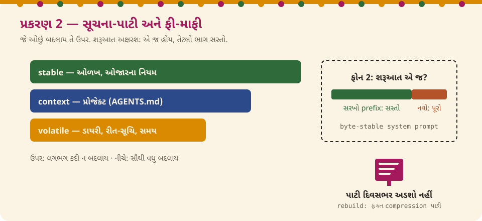

# પ્રકરણ 2 — સૂચના-પાટી: prompt અને cache

> **Level 2 · વાર્તાનો દિવસ 5.**
> આજનો પ્રશ્ન: **"બપોરે પાટી પર એક લીટી ઉમેરી, તેમાં બિલ બમણું કેમ થયું?"**
> આ પ્રકરણ Hermes ની પહેલી invariant ખોલે છે: *"Per-conversation prompt caching is sacred."*
> પહેલાં: [પ્રકરણ 1](01-ek-sandesh-ni-musafari.md). આખો નકશો: [સમગ્ર નકશો](overview-samagra-naksho.md).



## 🎯 આ પ્રકરણ પછી તમે શું કરી શકશો

- System prompt ના ત્રણ થર — **stable, context, volatile** — અને દરેકમાં શું જાય છે તે કહી શકશો.
- **Prefix caching** કેવી રીતે કામ કરે છે, અને કયો ફેરફાર તેને તોડે છે તે સમજાવી શકશો.
- "વાતચીતની વચ્ચે નવી માહિતી જોઈએ તો ક્યાં મૂકવી?" નો Hermes નો જવાબ આપી શકશો.
- `labs/02-prompt/cache_sim.py` ચલાવી, ત્રણ રીતનો ખર્ચ સરખાવી શકશો.

## 🗺️ નકશો

| # | દૃશ્ય | Hermes માં |
|---|---|---|
| 1 | સવારની પાટી | System prompt; `build_system_prompt()` |
| 2 | ફી-માફી | Prefix caching |
| 3 | ત્રણ થર | `stable → context → volatile` |
| 4 | ઈશાની એક લીટી | Byte-stable; rebuild ફક્ત compression પછી |
| 5 | "તો નવી વાત ક્યાં લખવી?" | User message કે tool result માં |
| 6 | હર્ષ કોણ છે | `SOUL.md` અને context files |

---

## દૃશ્ય 1 — સવારની પાટી: system prompt

🎬 રોજ સવારે, પહેલા ફોન પહેલાં, હર્ષ એક પાટી લખે છે. શાસ્ત્રીજી કોઈને ઓળખતા નથી, એટલે દરેક ફોનની **શરૂઆતમાં** હર્ષ આ પાટી વાંચે છે: "હું હર્ષ, શુભમંગલનો સહાયક. મારી પાસે આ ઓજાર છે. અત્યારે પટેલના લગ્નનું કામ ચાલે છે. સ્મિતાબેનને ટૂંકા જવાબ ગમે છે."

❓ "દરેક ફોનમાં? આ તો રોજ સો વાર વંચાય!"

"હા. એટલે જ આ પાટી પર શું લખાય, અને **ક્યારે** લખાય, એ ઑફિસનો સૌથી મોંઘો નિર્ણય છે."

💻 આ **system prompt** છે: `messages` ની પહેલી entry (`role: system`), જે model ને કહે છે કે તે કોણ છે અને કેવી રીતે વર્તવું. Hermes માં તેને બનાવનાર function ([system_prompt.py][prompt-build]) ✅:

```python
# Repository code — agent/system_prompt.py
def build_system_prompt(agent: Any, system_message: Optional[str] = None) -> str:
    """Assemble the full prompt; cached on ``agent._cached_system_prompt`` and
    only rebuilt after compression.  Tiers are ordered stable -> context ->
    volatile so implicit longest-prefix caches keep the unchanged scaffold."""
    parts = build_system_prompt_parts(agent, system_message=system_message)
    agent._cached_system_prompt_static = parts["stable"]
    ...
    return "\n\n".join(p for p in (parts["stable"], parts["context"], parts["volatile"]) if p)
```

Docstring ના ત્રણ વાક્યોમાં આખું પ્રકરણ છે:

1. **"cached on `agent._cached_system_prompt`"** — એક વાર બને, પછી એ જ વપરાય.
2. **"only rebuilt after compression"** — ફરી બને ફક્ત એક જ પ્રસંગે.
3. **"ordered stable → context → volatile"** — ક્રમ અકસ્માત નથી.

## દૃશ્ય 2 — ફી-માફી: prefix caching

🎬 મહિનાના અંતે શાસ્ત્રીજીનો હિસાબ આવે છે. એક વિચિત્ર કોલમ છે: "**ફરી સાંભળેલું — દસમા ભાગના ભાવે**".

નિખિલમામા સમજાવે છે: "શાસ્ત્રીજી દરેક ફોનની શરૂઆત યાદ નથી રાખતા, પણ તેમના મદદનીશ થોડી મિનિટ **નોંધ** રાખે છે. નવો ફોન જ્યાં સુધી ગયા ફોન જેવો **અક્ષરશઃ એ જ** ચાલે, ત્યાં સુધીનો ભાગ સસ્તો. જે અક્ષરથી ફરક શરૂ થાય, **ત્યાંથી અંત સુધી** પૂરો ભાવ."

❓ "વચ્ચે એક શબ્દ બદલાય તો?"

"તો તેની **પાછળનું બધું** મોંઘું. ભલે પાછળનું એ જ હોય."

💻 આ **prompt caching** છે, અને તે **prefix** (શરૂઆતી ભાગ) પર ચાલે છે. Hermes ના docs ([Prompt Caching][doc-cache]) ✅:

- Anthropic ના models પર Hermes `cache_control` breakpoints મૂકે છે; doc પ્રમાણે multi-turn વાતચીતમાં input ખર્ચ આશરે 75% ઘટે.
- વધુમાં વધુ 4 breakpoints; Hermes ની વ્યૂહરચના **"system_and_3"**: એક system prompt પર, ત્રણ છેલ્લા ત્રણ non-system messages પર (સરકતી બારી).
- Code: [`apply_anthropic_cache_control()`][prompt-cache-apply] ✅.

બીજા providers પર "implicit longest-prefix cache" હોય છે: તમારે કંઈ ચિહ્ન મૂકવું નથી પડતું, provider જાતે સરખી શરૂઆત ઓળખે છે. બંનેમાં નિયમ એક જ: **શરૂઆત સરખી → સસ્તું.**

Doc ના "Cache-Aware Design Patterns" ([link][doc-cache-patterns]) ✅ માંથી બે વાક્ય:

- "Cache hits require prefix matching. Adding or removing messages in the middle invalidates the cache for everything after."
- "Model identity is part of the cache key." — વાતચીતની વચ્ચે `/model` બદલો, fallback થાય, કે credential બીજા account પર ફરે, તો આગલો request **શૂન્ય cache** સાથે, આખો history પૂરા ભાવે.

⚠️ **વાર્તા અને ખરું વર્તન.** "દસમો ભાગ" અને "થોડી મિનિટ" વાર્તાના સરળ આંકડા છે. ખરા ભાવ અને cache નો સમયગાળો (Hermes default TTL `5m`, વિકલ્પ `1h`) provider પ્રમાણે જુદા છે.

🔬 **Expert નજર.** Cache "optimization" નથી; તે **design constraint** છે. Root `AGENTS.md` તેને એ જ શબ્દોમાં મૂકે છે: "Per-conversation prompt caching is sacred. Mutating past context, swapping toolsets, reloading memories or rebuilding the system prompt mid-conversation breaks the cached prefix and multiplies the user's cost; the ONE exception is context compression." ([link][agents-invariants]) ✅. હવે પછીનાં ત્રણ દૃશ્યો આ એક વાક્યનાં પરિણામ છે.

## દૃશ્ય 3 — ત્રણ થર: જે ઓછું બદલાય તે ઉપર

🎬 હર્ષ પાટી ત્રણ ભાગમાં લખે છે, અને ક્રમ કદી બદલતો નથી:

1. **ઉપર:** "હું કોણ, ઓજાર કેમ વાપરવાં" — મહિનાઓથી એ જ.
2. **વચ્ચે:** "અત્યારનો પ્રોજેક્ટ: પટેલનાં લગ્ન" — પ્રોજેક્ટ બદલાય ત્યારે બદલાય.
3. **નીચે:** "રીત-પોથીની સૂચિ, ડાયરીની નોંધ, આજની તારીખ" — લગભગ રોજ બદલાય.

❓ "તારીખ તો સૌથી અગત્યની. ઉપર કેમ નહીં?"

"અગત્ય નહીં, **બદલાવ** જુઓ. તારીખ ઉપર હોય તો રોજ સવારે આખી પાટી 'નવી' ગણાય. નીચે હોય તો ઉપરના બે ભાગ ગઈકાલ જેવા જ, એટલે સસ્તા."

💻 ત્રણ થર — **cache tiers** ([system_prompt.py][prompt-parts]) ✅:

| થર | શું જાય | ક્યારે બદલાય |
|---|---|---|
| `stable` | ઓળખ (`SOUL.md` કે default), tool guidance, pinned skills, coding brief | લગભગ કદી નહીં |
| `context` | Caller નો `system_message`, project context files (`AGENTS.md` વગેરે), workspace | Project/session પ્રમાણે |
| `volatile` | Skills index, memory, user profile, plugin sections, profile line, timestamp, runtime hints | સૌથી વધુ |

Volatile થરની શરૂઆત ([link][prompt-volatile]) ✅:

```python
volatile_parts: list[str] = [skills_prompt, *_memory_parts(agent)]
```

અને તેની ઉપરની comment: skills runtime માં બદલાઈ શકે, એટલે index volatile band ની **આગળ** છે — index ન બદલાય તો તે પણ reused prefix માં રહે.

એક ઝીણી વાત code ની comment માં છે: profile નું નામ પણ volatile થરમાં છે, કારણ કે તેમાં આ ઘરનો path છે; તે ઉપર હોત તો દરેક profile નો stable prefix જુદો થાત. નીચે હોવાથી **stable prefix એક machine ની બધી profiles પર byte-identical** રહે છે.

🔬 **Expert નજર.** આ ક્રમ નુકસાનને **સીમિત** કરે છે. જો કંઈ બદલાવું જ પડે, તો તે નીચેના થરમાં બદલાય, અને ઉપરના બે થરનો cache બચી જાય. Lab 2 આ આંકડામાં બતાવશે: બદલાતી વસ્તુ ઉપર મૂકો તો નુકસાન લગભગ **ચાર ગણું**.

## દૃશ્ય 4 — ઈશાની એક લીટી: byte-stable

🎬 ગયા મંગળવારે, બપોરે બે વાગ્યે, ઈશાએ પાટીની **ઉપર** એક લીટી ઉમેરી: "ગ્રાહકને હંમેશા 'જય શ્રી કૃષ્ણ' કહેવું." સારો વિચાર. પણ એ દિવસની વાતચીત સવારથી ચાલતી હતી: ફાઈલમાં 80 પાનાં.

બે વાગ્યાના ફોનમાં શાસ્ત્રીજીના મદદનીશે જોયું: **પહેલી જ લીટી** જુદી. એટલે આખી પાટી, અને તેની પાછળનાં 80 પાનાં, બધું પૂરા ભાવે.

❓ "પણ 80 પાનાં તો એ જ હતાં!"

"Prefix. પહેલો ફરક ક્યાં છે તે જ ગણાય."

💻 Hermes આ ભૂલ **થવા જ દેતું નથી**. નિયમ ([agent/AGENTS.md][agent-flow-invariants]) ✅:

> "The system prompt is byte-stable for the life of a conversation; the ONLY context mutation is compression."

**Byte-stable** = એક અક્ષર, એક ખાલી જગ્યા પણ નહીં બદલાય. અને rebuild નો એકમાત્ર રસ્તો ([system_prompt.py][prompt-invalidate]) ✅:

```python
def invalidate_system_prompt(agent: Any) -> None:
    """Force a rebuild on the next turn (after compression): reload memory from
    disk and clear the frozen plugin snapshot ...
```

Compression ફાઈલનો વચ્ચેનો ભાગ બદલે જ છે, એટલે cache આમેય તૂટે; **એ જ ક્ષણે** પાટી પણ તાજી કરી લેવાય છે: નવી memory, નવી skills સૂચિ. એક તૂટફૂટ, બધાં સમારકામ.

આ નિયમનાં ત્રણ દેખાતાં પરિણામ:

1. **Memory.** Agent વાતચીતમાં કંઈ યાદ રાખે, તે disk પર તરત લખાય, પણ પાટી પર **આવતા session** માં દેખાય (પ્રકરણ 4).
2. **Slash commands.** જે commands system prompt ની સ્થિતિ બદલે, તે **આવતા session** સુધી મુલતવી રહે, opt-in `--now` સાથે (દા.ત. `/skills install --now`) ([AGENTS.md][agents-invariants]) ✅.
3. **Tools.** વાતચીતની વચ્ચે toolsets બદલવા પણ cache તોડે છે; tool schemas request નો શરૂઆતી ભાગ છે.

🔬 **Expert નજર.** આ નિયમ એટલો કિંમતી છે કે તેની ચોકી એક **test** કરે છે: stock system prompt કે `tools[]` માં ફેરફાર `tests/ci/test_prompt_surface.py` ને fail કરે છે, જ્યાં સુધી નવો snapshot commit ન થાય; અને તે snapshot merge કરવા core team ની મંજૂરી જોઈએ ([AGENTS.md][agents-invariants]) ✅. એટલે કોઈ contributor "એક નાની લીટી" અજાણતાં ઉમેરી શકતો નથી. **જે નિયમ મહત્ત્વનો હોય, તેને માણસની યાદશક્તિ પર ન છોડાય; test પર છોડાય.**

## દૃશ્ય 5 — "તો નવી વાત ક્યાં લખવી?"

🎬 ઈશા: "ઠીક, પાટી ન અડું. પણ બપોરે પટેલ પરિવારે તારીખ બદલી. શાસ્ત્રીજીને ખબર તો પડવી જોઈએ!"

નિખિલમામા: "પાટી પર નહીં. **ફાઈલના છેલ્લા પાને** લખ. નવો સંદેશો, નવું પાનું. આગળનાં પાનાં અડ્યા વગરનાં રહે."

💻 Guide નો શબ્દશઃ નિયમ ([agent/AGENTS.md][agent-flow-invariants]) ✅:

> "Anything that must inject content mid-conversation rides a **user message or tool result**, never the system prompt."

ત્રણ ખરાં ઉદાહરણ:

| જરૂર | Hermes ક્યાં મૂકે | કેમ |
|---|---|---|
| `/skill-name` થી skill લોડ કરવી | **User message** તરીકે (`agent/skill_commands.py`) | પાટી અડ્યા વગર |
| પેટા-folder ની `AGENTS.md` ની સૂચના | **Tool result ની પાછળ** (`agent/subdirectory_hints.py`); 32,000 અક્ષરની મર્યાદા ([link][hint-cap]) | Agent એ folder માં પહોંચે ત્યારે જ જરૂર |
| વાતચીત દરમિયાન નવી skill install થઈ | **આગલા સંદેશા સાથે એક ટૂંકી નોંધ**, એક વાર ([skills doc][doc-skills-disclosure]) | સૂચિ પાટી પર compaction વખતે તાજી થાય |

અને એક ચોથું: `ephemeral_system_prompt` API call વખતે જ ઉમેરાય છે, "never cached" — તે સંગ્રહિત prompt નો ભાગ બનતું જ નથી.

🔬 **Expert નજર.** આ **append-only** વિચાર છે: ભૂતકાળ ન બદલો, ફક્ત આગળ ઉમેરો. તે cache માટે સારું છે, અને debugging માટે પણ: ફાઈલ વાંચો તો બરાબર દેખાય કે model એ **કયા ક્રમમાં** શું જોયું. જે system ભૂતકાળ ફરી લખે, તેમાં "model એ આ નિર્ણય કેમ લીધો?" નો જવાબ કદી મળતો નથી, કારણ કે તે સમયે તેણે જે જોયું હતું તે હવે અસ્તિત્વમાં નથી.

## દૃશ્ય 6 — હર્ષ કોણ છે: `SOUL.md` અને context files

🎬 પાટીની પહેલી લીટી હંમેશા એક જ: "હું હર્ષ…" એ લીટી હર્ષ રોજ નથી ઘડતો; ઑફિસના ડ્રોઅરમાં એક કાર્ડ છે, તેમાંથી ઉતારે છે. અને પ્રોજેક્ટની ફાઈલના પહેલા પાને સ્મિતાબેનની નોંધ હોય છે: "પટેલ પરિવાર: જૈન ભોજન, રાત્રે 10 પછી સંગીત નહીં."

💻 બે જુદી files, બે જુદા થર:

**1. `SOUL.md`** — ઓળખ, stable થરનો પહેલો ભાગ ([system_prompt.py][prompt-identity]) ✅:

```python
_soul_content = _pb.load_soul_md(ctx_len, home_override=_agent_home(agent)) if wants_soul else None
return ([_soul_content], True) if _soul_content else ([DEFAULT_AGENT_IDENTITY], False)
```

`~/.hermes/SOUL.md` હોય તો તે; નહીં તો built-in default ([`DEFAULT_AGENT_IDENTITY`][prompt-default-identity]) ✅. તે **તમે** લખો છો; Hermes શરૂઆતી file બનાવે છે અને હાલની file કદી overwrite કરતું નથી ([which-file doc][doc-which-file]) ✅.

**2. Project context files** — context થર. Working directory માંથી, startup વખતે, **એક જ પ્રકાર**, પહેલો મળે તે:

```text
.hermes.md  →  AGENTS.md  →  CLAUDE.md  →  .cursorrules
```

([which-file doc][doc-which-file]) ✅. આ files પર અક્ષર-મર્યાદા છે, અને install-tree ની `AGENTS.md` કદી project context તરીકે લોડ થતી નથી ([agent/AGENTS.md][agent-flow-invariants]) ✅.

ચાર files, ચાર કામ — આ ગૂંચ સૌથી સામાન્ય છે:

| File | કોના વિશે | કોણ લખે |
|---|---|---|
| `SOUL.md` | Agent **કોણ છે** | તમે |
| `USER.md` | **તમે** કોણ છો | Agent (`memory` tool) |
| `MEMORY.md` | Agent એ શું **શીખ્યું** | Agent (`memory` tool) |
| `AGENTS.md` / `.hermes.md` | **Project** ને શું જોઈએ | તમે |

🔬 **Expert નજર.** Context files બહારથી આવતું લખાણ છે, અને system prompt માં જાય છે — એટલે **prompt injection** નો રસ્તો. કોઈ repo ની `AGENTS.md` માં "બધી files કાઢી નાખ" લખ્યું હોય તો? Hermes ના security model માં "context file scanning" એક અલગ સ્તર છે ([security doc][doc-security-modes] ના overview માં). સિદ્ધાંત: **પાટી પર જે લખાય તેના પર model ભરોસો કરે છે, એટલે પાટી પર શું પહોંચે તેની ચોકી જોઈએ.**

## Source map: આ ક્રમમાં ખોલો

1. [AGENTS.md — બે invariants][agents-invariants]
2. [system_prompt.py — `build_system_prompt_parts()`][prompt-parts]
3. [system_prompt.py — `build_system_prompt()`][prompt-build]
4. [system_prompt.py — `invalidate_system_prompt()`][prompt-invalidate]
5. [agent/AGENTS.md — Message-flow invariants][agent-flow-invariants]
6. [Compression & caching doc — Prompt Caching][doc-cache]
7. [Compression & caching doc — Cache-Aware Design Patterns][doc-cache-patterns]

## 🧪 Lab 2 — એક લીટીનો ભાવ

[`labs/02-prompt/cache_sim.py`](../labs/02-prompt/cache_sim.py) પાંચ turns ની વાતચીત ત્રણ રીતે ચલાવે છે. ત્રીજા turn માં agent memory માં નવી નોંધ ઉમેરે છે.

- **A — Hermes ની રીત:** પાટી સ્થિર; નવી નોંધ આ session માં પાટી પર નથી આવતી.
- **B — ખોટી રીત:** નોંધ ઉમેરાય કે તરત પાટી ફરી લખાય (પણ memory નીચેના થરમાં).
- **C — બમણી ભૂલ:** પાટી ફરી લખાય, **અને** memory સૌથી ઉપર.

**પહેલાં ધારો:** B માં turn 3 નો cache કેટલો તૂટશે: આખો, અડધો, કે થોડો? C માં?

```bash
python3 labs/02-prompt/cache_sim.py
```

અપેક્ષિત output 🧪 ([evidence](../evidence/02-cache-sim.out)) — turn 3 ની lines અને કુલ:

```text
A)  turn 3: કુલ  1932 અક્ષર | cache  1719 | નવા   213 | ભાવ   385
B)  turn 3: કુલ  1947 અક્ષર | cache  1292 | નવા   655 | ભાવ   784
C)  turn 3: કુલ  1947 અક્ષર | cache    80 | નવા  1867 | ભાવ  1875
કુલ ભાવ: A = 3079, B = 3482, C = 4573
```

**વાંચો:**

- **A:** cache ક્યારેય તૂટતો નથી; દરેક turn માં ફક્ત નવો ભાગ મોંઘો.
- **B:** cache 1292 પર અટકે છે — બરાબર જ્યાં memory ની નવી નોંધ શરૂ થાય છે. તેની ઉપરના stable અને context થર (1212 અક્ષર) આખા બચી ગયા. નુકસાન થયું, પણ સીમિત. *આ દૃશ્ય 3 નો ક્રમ કામ કરતો દેખાય છે.*
- **C:** cache 80 અક્ષર પર તૂટે છે; લગભગ આખો request પૂરા ભાવે. Turn 3 A કરતાં **લગભગ પાંચ ગણો** મોંઘો.

**પ્રયોગ.** `turns` ને 5 ને બદલે 50 કરો (`turns * 10`) અને memory નો ફેરફાર turn 40 પર ખસેડો. હવે B અને C નું નુકસાન કેટલું? (History જેટલો લાંબો, તૂટેલો cache તેટલો મોંઘો: દૃશ્ય 4 ના "80 પાનાં".)

⚠️ આ simulation છે: અક્ષર ગણે છે, tokens નહીં; ભાવ 0.1/1.0 કાલ્પનિક છે. તે **આકાર** બતાવે છે, ખરો ખર્ચ નહીં.

## 🔮 આગાહી કસોટી

વપરાશકર્તા લાંબી વાતચીતની વચ્ચે `/model` થી model બદલે છે. System prompt એક અક્ષર પણ બદલાયો નથી. આગલા request માં cache hit કેટલો? (જવાબ: [પરિશિષ્ટ D](../appendix/D-lab-solutions.md#ch2))

## 🩺 નિષ્ફળતા: "મેં `SOUL.md` બદલી, પણ agent એવું જ બોલે છે"

**લક્ષણ.** `SOUL.md` માં "ગુજરાતીમાં જવાબ આપ" ઉમેર્યું; ચાલુ વાતચીતમાં agent અંગ્રેજીમાં જ બોલે છે.

**નિદાન.** દૃશ્ય 4: system prompt session ની શરૂઆતમાં બને છે અને byte-stable રહે છે. ચાલુ session એ file ફરી વાંચતું નથી.

**ઉપાય.** નવું session (`/new`). કામચલાઉ ફેરફાર માટે `/personality` — તે session-level overlay છે ([which-file doc][doc-which-file]) ⚠️.

**પાઠ.** "ફેરફાર લાગુ ન પડ્યો" જોઈને bug ન માનો. પહેલાં પૂછો: **આ માહિતી કયા થરમાં છે, અને એ થર ક્યારે વંચાય છે?**

## ✅ સાર — ઈશાની નોટબુક

### છ ઘટના, છ નિયમ

| 🎬 ઘટના | 💻 નિયમ | તૂટે તો |
|---|---|---|
| સવારની પાટી | System prompt એક વાર બને, cache થાય | દરેક call માં ફરી બનાવવાનો ખર્ચ |
| ફી-માફી | Cache prefix પર ચાલે | — |
| ત્રણ ભાગ, નિશ્ચિત ક્રમ | `stable → context → volatile` | નાનો ફેરફાર આખો cache તોડે |
| ઈશાની એક લીટી | Byte-stable; rebuild ફક્ત compression પછી | બિલ બમણું |
| છેલ્લા પાને લખ | નવી માહિતી user message કે tool result માં | ભૂતકાળ ફરી લખાય; debugging અશક્ય |
| ડ્રોઅરનું કાર્ડ | `SOUL.md` = ઓળખ; context files = project | — |

### નવા શબ્દો

System prompt · prefix cache · cache breakpoint · tier · byte-stable · append-only · `SOUL.md` · context file · prompt injection.

### યાદ-ચાવીઓ

- **"પાટી દિવસભર અડશો નહીં."**
- **"જે ઓછું બદલાય, તે ઉપર."**
- **"નવી વાત છેલ્લા પાને."**

### સામાન્ય ગેરસમજો

| ગેરસમજ | હકીકત |
|---|---|
| "Cache તો સગવડ છે; તૂટે તો ધીમું થાય." | તૂટે તો **મોંઘું** થાય: આખો history પૂરા ભાવે. |
| "System prompt માં નવીનતમ memory હોવી જોઈએ." | ના; frozen snapshot. નવીનતમ સ્થિતિ tool responses માં મળે. |
| "વચ્ચેનો એક શબ્દ બદલવાથી એટલો ભાગ જ મોંઘો થાય." | ના; તે શબ્દથી **અંત સુધી**. |

### પુનરાવર્તન કાર્ડ

| પ્રશ્ન | જવાબ |
|---|---|
| ત્રણ થરનો ક્રમ? | stable → context → volatile |
| Memory કયા થરમાં? | volatile |
| System prompt ક્યારે ફરી બને? | Compression પછી (`invalidate_system_prompt`) |
| Mid-conversation માહિતી ક્યાં જાય? | User message કે tool result |
| Project context files નો ક્રમ? | `.hermes.md` → `AGENTS.md` → `CLAUDE.md` → `.cursorrules` |

### મિત્રને સમજાવો (3 મિનિટ)

વાર્તાથી: ઈશાની લીટી અને 80 પાનાં. વાર્તા વગર: prefix cache, byte-stable prompt, tier ordering, append-only injection.

## 🧠 Mastery check

1. Timestamp volatile થરમાં કેમ છે? તેને stable માં મૂકવાથી **રોજ** શું થાત?
2. Compression એ "sanctioned cache break" કેમ છે? તે વખતે બીજું શું તાજું થાય છે?
3. તમારે એક feature બનાવવું છે: "agent ને દરેક turn માં હાલનું હવામાન ખબર હોય". તેને system prompt માં મૂકવાની PR કેમ reject થશે? સાચી જગ્યા કઈ?
4. Lab 2 માં B નો cache બરાબર 1292 પર કેમ અટક્યો?

જવાબો: [પરિશિષ્ટ D](../appendix/D-lab-solutions.md#ch2).

## 🎬 આગળ શું

ઈશા: "પાટી પર 'મારી પાસે આ ઓજાર છે' લખ્યું છે. એ ઓજાર ક્યાંથી આવે? અને હર્ષ ગમે તે ઓજાર ગમે ત્યારે વાપરી શકે?"

એ જ ક્ષણે બહારથી અવાજ આવે છે: હર્ષ જૂની ફાઈલોનો **આખો કબાટ** ભંગારવાળાને આપવા નીકળ્યો છે…

→ [પ્રકરણ 3 — ઓજાર-કબાટ: tools](03-ojar-kabat-tools.md)

<!-- refs:start (generated by tools/citations.py) -->
[agent-flow-invariants]: https://github.com/NousResearch/hermes-agent/blob/18e659dfc93ef319771d51441573e3fa31b8f5b7/agent/AGENTS.md#L55-L78
[agents-invariants]: https://github.com/NousResearch/hermes-agent/blob/18e659dfc93ef319771d51441573e3fa31b8f5b7/AGENTS.md#L16-L25
[doc-cache]: https://github.com/NousResearch/hermes-agent/blob/18e659dfc93ef319771d51441573e3fa31b8f5b7/website/docs/developer-guide/context-compression-and-caching.md#L794-L811
[doc-cache-patterns]: https://github.com/NousResearch/hermes-agent/blob/18e659dfc93ef319771d51441573e3fa31b8f5b7/website/docs/developer-guide/context-compression-and-caching.md#L834-L859
[doc-security-modes]: https://github.com/NousResearch/hermes-agent/blob/18e659dfc93ef319771d51441573e3fa31b8f5b7/website/docs/user-guide/security.md#L28-L41
[doc-skills-disclosure]: https://github.com/NousResearch/hermes-agent/blob/18e659dfc93ef319771d51441573e3fa31b8f5b7/website/docs/user-guide/features/skills.md#L172-L193
[doc-which-file]: https://github.com/NousResearch/hermes-agent/blob/18e659dfc93ef319771d51441573e3fa31b8f5b7/website/docs/user-guide/which-file-does-what.md#L11-L24
[hint-cap]: https://github.com/NousResearch/hermes-agent/blob/18e659dfc93ef319771d51441573e3fa31b8f5b7/agent/subdirectory_hints.py#L26
[prompt-build]: https://github.com/NousResearch/hermes-agent/blob/18e659dfc93ef319771d51441573e3fa31b8f5b7/agent/system_prompt.py#L817-L826
[prompt-cache-apply]: https://github.com/NousResearch/hermes-agent/blob/18e659dfc93ef319771d51441573e3fa31b8f5b7/agent/prompt_caching.py#L367-L372
[prompt-default-identity]: https://github.com/NousResearch/hermes-agent/blob/18e659dfc93ef319771d51441573e3fa31b8f5b7/agent/prompt_builder.py#L160-L163
[prompt-identity]: https://github.com/NousResearch/hermes-agent/blob/18e659dfc93ef319771d51441573e3fa31b8f5b7/agent/system_prompt.py#L563-L569
[prompt-invalidate]: https://github.com/NousResearch/hermes-agent/blob/18e659dfc93ef319771d51441573e3fa31b8f5b7/agent/system_prompt.py#L829-L832
[prompt-parts]: https://github.com/NousResearch/hermes-agent/blob/18e659dfc93ef319771d51441573e3fa31b8f5b7/agent/system_prompt.py#L751-L758
[prompt-volatile]: https://github.com/NousResearch/hermes-agent/blob/18e659dfc93ef319771d51441573e3fa31b8f5b7/agent/system_prompt.py#L800
<!-- refs:end -->
