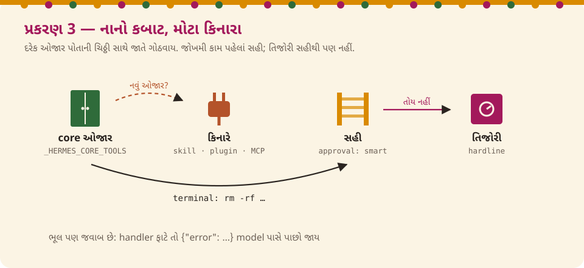

# પ્રકરણ 3 — ઓજાર-કબાટ: tools

> **Level 3 · વાર્તાનો દિવસ 6–7.**
> આજના બે પ્રશ્ન: **"હર્ષના હાથ ક્યાંથી આવે?"** અને **"તેને કોણ રોકે?"**
> આ પ્રકરણ Hermes ની બીજી invariant ખોલે છે: *"The core is a narrow waist; capability lives at the edges."*
> પહેલાં: [પ્રકરણ 2](02-suchna-pati-prompt-ane-cache.md). આખો નકશો: [સમગ્ર નકશો](overview-samagra-naksho.md).



## 🎯 આ પ્રકરણ પછી તમે શું કરી શકશો

- Tool ના ચાર ભાગ — **name, schema, handler, check_fn** — ઓળખી શકશો.
- `tools/registry.py` માં tool ની નોંધણીથી dispatch સુધીનો રસ્તો trace કરી શકશો.
- "નવું tool કે skill?" નો નિર્ણય Hermes ના **footprint ladder** પ્રમાણે લઈ શકશો.
- જોખમી command ની મંજૂરી ના ત્રણ modes અને **hardline** સીમા સમજાવી શકશો.

## 🗺️ નકશો

| # | દૃશ્ય | Hermes માં |
|---|---|---|
| 1 | દરેક ઓજાર પર ચિઠ્ઠી | Schema: model શું જુએ છે |
| 2 | ઓજાર જાતે ગોઠવાય | Self-registration; AST discovery |
| 3 | ચાવી ન હોય તો ઓજાર દેખાય જ નહીં | `check_fn`; `get_definitions()` |
| 4 | તૂટેલું ઓજાર | `dispatch()`: દરેક ભૂલ JSON માં |
| 5 | 200 ઓજારનો કબાટ | Narrow waist; toolsets; footprint ladder |
| 6 | ભંગારવાળો | Dangerous-command approval; hardline |
| 7 | ત્રીસ ભાવપત્રક | `execute_code`: ફક્ત `print()` context માં |
| 8 | બહારનાં 300 ઓજાર | Tool Search: ત્રણ bridge tools |

---

## દૃશ્ય 1 — દરેક ઓજાર પર ચિઠ્ઠી: schema

🎬 ઑફિસના ઓજાર-કબાટમાં દરેક વસ્તુ પર એક ચિઠ્ઠી ચોંટેલી છે: **નામ**, **શું કામ કરે**, અને **વાપરવા શું આપવું પડે**. "માપપટ્ટી — લંબાઈ માપે — શું માપવું છે તે કહો."

શાસ્ત્રીજી કાશીમાં છે; તેમણે કબાટ કદી જોયો નથી. હર્ષ દરેક ફોનમાં આ ચિઠ્ઠીઓ **વાંચી સંભળાવે છે**, અને શાસ્ત્રીજી ફક્ત ચિઠ્ઠી સાંભળીને નક્કી કરે છે કે કયું ઓજાર માગવું.

❓ "એટલે ચિઠ્ઠી ખરાબ લખી હોય તો?"

"તો સારામાં સારું ઓજાર પણ કદી વપરાય નહીં. અથવા ખોટી જગ્યાએ વપરાય."

💻 Tool ના ચાર ભાગ:

| ભાગ | શું છે | કોના માટે |
|---|---|---|
| **name** | અનોખું નામ, દા.ત. `read_file` | Model અને registry |
| **schema** | `description` + `parameters` (JSON Schema) | **Model** — તે ફક્ત આ જ જુએ છે |
| **handler** | ખરેખર કામ કરતું function | Agent |
| **check_fn** | "અત્યારે આ tool વપરાય તેમ છે?" | Registry |

Plugin guide નું વાક્ય: "The `description` field is how the LLM decides when to use your tool." ✅ Model તમારો handler code કદી જોતું નથી.

Hermes નું એક ખરું, નાનું ઉદાહરણ — `todo_list` ([todo_tool.py][todo-register]) ✅:

```python
# Repository code — tools/todo_tool.py
registry.register(
    name="todo_list", toolset="todo", schema=TODO_SCHEMA, check_fn=check_todo_requirements,
    handler=lambda args, **kw: todo_tool(
        todos=args.get("todos"), merge=args.get("merge", False), store=kw.get("store")),
    emoji="📋")
```

🔬 **Expert નજર.** Schema એ **prompt નો ભાગ** છે: તે દરેક request માં જાય છે, અને તેનો દરેક શબ્દ model ના નિર્ણયને અસર કરે છે. એટલે પ્રકરણ 2 નો નિયમ અહીં પણ લાગુ: `tools[]` નો ફેરફાર prompt-surface snapshot test ને fail કરે છે. Tool નું description બદલવું એ "નાનો doc ફેરફાર" નથી; એ **વર્તનનો ફેરફાર** છે.

## દૃશ્ય 2 — ઓજાર જાતે ગોઠવાય: self-registration

🎬 પહેલાં કબાટની એક **યાદી** હતી, જે સ્મિતાબેન હાથે લખતાં. નવું ઓજાર આવે, અને યાદીમાં લખવાનું ભુલાઈ જાય: ઓજાર કબાટમાં છે, પણ કોઈને ખબર નથી.

નવો નિયમ: "યાદી કોઈ નહીં લખે. **દરેક ઓજાર પોતાની ચિઠ્ઠી પોતે લઈને આવે.** સવારે જે કબાટમાં ચિઠ્ઠી સાથે હાજર, તે યાદીમાં."

💻 Hermes માં કોઈ હાથે લખેલી import list નથી. Architecture doc ([File Dependency Chain][doc-arch-depchain]) ✅:

```text
tools/registry.py  (no deps — imported by all tool files)
       ↑
tools/*.py  (each calls registry.register() at import time)
       ↑
model_tools.py  (imports tools/registry + triggers tool discovery)
       ↑
run_agent.py, cli.py, batch_runner.py, environments/
```

"Any `tools/*.py` file with a top-level `registry.register()` call is auto-discovered."

પણ Hermes કઈ files import કરવી તે કેવી રીતે જાણે? તે file ને **ચલાવ્યા વગર વાંચે છે** ([registry.py][registry-discover]) ✅:

```python
# Repository code — tools/registry.py
def _module_registers_tools(module_path: Path) -> bool:
    """True when the module body (or a module-level ``for``) calls ``registry.register(...)``.
    Only module-body statements count, so helpers registering inside a function are skipped;
    a text prefilter avoids ``ast.parse`` for files lacking both words."""
```

- **AST** (abstract syntax tree) = code નું બંધારણ, ચલાવ્યા વગર. Hermes દરેક file ના AST માં જુએ છે કે સૌથી ઉપરના સ્તરે `registry.register(...)` છે કે નહીં.
- પહેલાં સસ્તી text તપાસ ("registry" અને "register" બંને શબ્દ છે?), પછી જ મોંઘું `ast.parse`.
- Scan ના પરિણામ disk પર cache થાય છે, file ના `(mtime_ns, size)` પ્રમાણે.

અને નોંધણી વખતે જ ખરાબ ઓજાર પકડાય ([registry.py][registry-register]) ✅: `schema` dict ન હોય, કે `parameters` object ન હોય, તો `ValueError` — **તે ક્ષણે**, tool ના નામ સાથે. Comment કારણ આપે છે: ખરાબ schema દરેક provider request માં જાય અને "400s the whole turn far from the offending plugin".

🔬 **Expert નજર.** આ **"fail early, fail near"** છે: ભૂલ જ્યાં જન્મી ત્યાં જ, અને જન્મતાંવેંત પકડો. વિકલ્પ વિચારો: ખરાબ schema ચૂપચાપ નોંધાય; ત્રણ દિવસ પછી કોઈ વપરાશકર્તાનો turn "400 Bad Request" થી તૂટે; error માં tool નું નામ પણ નથી. Debugging નો સમય = ભૂલ અને તેના લક્ષણ વચ્ચેનું **અંતર**.

## દૃશ્ય 3 — ચાવી ન હોય તો ઓજાર દેખાય જ નહીં: `check_fn`

🎬 કબાટમાં એક કેમેરા છે, પણ તેની બેટરી સ્મિતાબેનના ડ્રોઅરમાં બંધ છે. એક દિવસ હર્ષ ફોનમાં ચિઠ્ઠી વાંચે છે: "કેમેરા — ફોટો પાડે." શાસ્ત્રીજી તરત માગે છે: "મંડપનો ફોટો પાડ." હર્ષ: "બેટરી નથી." શાસ્ત્રીજી: "ફરી પ્રયત્ન કર." એક ફોન નકામો, બીજો નકામો.

નિયમ: "બેટરી ન હોય, તો કેમેરાની ચિઠ્ઠી **વાંચવી જ નહીં**. જે વપરાય તેમ નથી, તે શાસ્ત્રીજીને ખબર જ ન પડવી જોઈએ."

💻 Model ને મોકલાતી યાદી બનાવનાર method ([registry.py][registry-getdefs]) ✅:

```python
# Repository code — tools/registry.py
def get_definitions(self, tool_names: set[str], quiet: bool = False) -> list[dict]:
    """OpenAI-format schemas for the requested tools whose ``check_fn`` passes (or is
    absent). Probes use the ~30 s TTL cache so ``hermes tools enable`` lands quickly."""
    ...
    for name in sorted(tool_names):
        entry = entries_by_name.get(name)
        if not entry:
            continue
        if entry.check_fn and not _memo_check(entry.check_fn, check_results):
            ...
            continue
```

બે વાત ધ્યાનથી જુઓ:

1. **`check_fn` fail → `continue`.** Tool યાદીમાંથી **ગાયબ**. API key નથી? Service પહોંચમાં નથી? Model ને તે tool દેખાતું જ નથી.
2. **`sorted(tool_names)`.** યાદી હંમેશા **એ જ ક્રમમાં**. કેમ? પ્રકરણ 2: tool schemas request ના શરૂઆતી ભાગમાં છે; ક્રમ બદલાય તો cache તૂટે. એક નાનો `sorted()` — અને પ્રકરણ 2 ની આખી invariant તેના પર ટકેલી.

🔬 **Expert નજર.** Guide `check_fn` ની સીમા બાંધે છે: તે "reachability/opt-in" નો જવાબ આપે, "never per-session surface" ([AGENTS.md][agents-footprint]) ✅. એટલે `check_fn` "આ વાતચીતમાં આ tool જોઈએ?" નક્કી ન કરે; ફક્ત "આ tool **ચાલી શકે** તેમ છે?" કારણ: session પ્રમાણે tools બદલાય તો દરેક session નો `tools[]` જુદો, અને cache નો લાભ ઓછો.

## દૃશ્ય 4 — તૂટેલું ઓજાર: ભૂલ પણ એક જવાબ છે

🎬 હર્ષ સીડી પર ચડીને તોરણ બાંધતો હતો; સીડીનું પગથિયું તૂટ્યું. હર્ષ પડ્યો, અને **કામ છોડીને ઘરે જતો રહ્યો**. શાસ્ત્રીજી ફોન પર રાહ જોતા રહ્યા. ગ્રાહક રાહ જોતો રહ્યો.

સ્મિતાબેન: "ઓજાર તૂટે, તો ઘરે નહીં જવાનું. શાસ્ત્રીજીને ફોન કરીને **કહેવાનું**: 'સીડી તૂટી, પગથિયું ત્રીજું.' તે બીજો રસ્તો બતાવશે."

💻 Tool ચલાવનાર method ([registry.py][registry-dispatch]) ✅:

```python
# Repository code — tools/registry.py
def dispatch(
    self, name: str, args: dict, *, scope: Optional[str] = None, **kwargs) -> str | dict:
    """Execute a tool handler by name: async handlers bridged via ``_run_async()``,
    results normalized, every exception returned as ``{"error": ...}``."""
    ...
    entry = self.get_entry(name, scope=scope)
    if not entry:
        return tool_error(f"Unknown tool: {name}")
    ...
    except Exception as e:
        ...
        raw = f"Tool execution failed: {error_type_name(e)}: {e}"
```

- અજાણ્યું tool → **error result**, crash નહીં.
- Handler exception ફેંકે → પકડાય, અને `{"error": "Tool execution failed: …"}` બનીને **model પાસે પાછો જાય**.

Model એ error વાંચે છે અને ઘણી વાર જાતે સુધારે છે: path ખોટો હતો તો સાચો શોધે; command fail થયો તો બીજો અજમાવે. Loop ચાલુ રહે છે.

Plugin guide handler લખનાર માટે એ જ નિયમ આપે છે ([link][doc-plugin-handlers]) ✅: હંમેશા JSON string; **never raise**; `**kwargs` સ્વીકારો.

⚠️ **વાર્તા અને ખરું વર્તન.** Dispatch સુધી પહોંચતાં પહેલાં call `handle_function_call()` માંથી પસાર થાય છે ([model_tools.py][handle-fc]) ✅: argument coercion, જૂનાં tool નામોના aliases, plugin hooks (`pre_tool_call` / `post_tool_call`) અને middleware. Registry છેલ્લું સ્ટેશન છે, એકમાત્ર નહીં.

🔬 **Expert નજર.** Agent માટે **error એ data છે**. સામાન્ય program માં exception એટલે "અટકો". Agent માં exception એટલે "model ને કહો; તે નક્કી કરશે". આ તફાવત agent engineering નો પાયો છે. અને તેની બીજી બાજુ: error message **model વાંચશે**, એટલે તે સ્પષ્ટ અને કામનો હોવો જોઈએ. Code માં error text sanitize પણ થાય છે, જેથી exception ના લખાણમાંના framing tokens model ને ગૂંચવે નહીં.

## દૃશ્ય 5 — 200 ઓજારનો કબાટ: narrow waist

🎬 ઈશાને વિચાર આવે છે: "વધુ ઓજાર = વધુ કામ!" તે બજારમાંથી 200 ઓજાર લાવે છે. બીજા દિવસે દરેક ફોન **દસ મિનિટ** મોડો શરૂ થાય છે: હર્ષ 200 ચિઠ્ઠીઓ વાંચે છે. અને શાસ્ત્રીજી ગૂંચવાય છે: ત્રણ જાતની માપપટ્ટી છે; કઈ માગવી?

સ્મિતાબેન કબાટ ખાલી કરાવે છે. "રોજ જોઈએ તે **કબાટમાં**. ખાસ કામનું ઓજાર **થેલામાં**, તે કામે જ લઈ જવાનું. અને જે ઓજાર **રીત લખવાથી** ચાલી જાય, તે ખરીદવું જ નહીં."

💻 આ બીજી invariant છે ([AGENTS.md][agents-invariants]) ✅:

> "The core is a narrow waist; capability lives at the edges. Every model tool is sent on every API call, so the bar for a new *core* tool is high."

**Core tools** ની યાદી એક જ જગ્યાએ છે — `_HERMES_CORE_TOOLS` ([toolsets.py][toolsets-core]) ✅. તેમાંથી મુખ્ય:

| જૂથ | Tools |
|---|---|
| Web | `web_search`, `web_extract` |
| Terminal | `terminal`, `process_manage` |
| Files | `read_file`, `write_file`, `patch`, `search_files` |
| Skills | `skills_list`, `skill_view`, `skill_manage` |
| યાદ | `todo_list`, `memory`, `session_search` |
| બીજા | `clarify`, `execute_code`, `delegate_task`, `cronjob_manage`, `browser_exec`, `vision_analyze`… |

**Toolset** (થેલો) = tools નું નામવાળું જૂથ. દરેક platform નો પોતાનો bundle છે, અને કેટલાક જાણીજોઈને **નાના**: webhook માટેની યાદી ફક્ત `web_search`, `web_extract`, `vision_analyze`, `clarify` છે; comment: "Webhook payloads are untrusted third-party content: no file/system execution." ✅ અજાણ્યા પાસેથી આવેલા સંદેશા પર terminal નહીં.

**નવી ક્ષમતા ક્યાં મૂકવી?** — **footprint ladder**: જે પગથિયું પહેલું કામ કરે, તે લો ([AGENTS.md][agents-footprint]) ✅:

```text
1. હાલનો code વિસ્તારો
2. CLI command + skill
3. Service-gated tool (check_fn)
4. Plugin
5. Catalog માં MCP server
6. નવું core tool  ← છેલ્લો ઉપાય: "fundamental, broadly useful, unreachable otherwise"
```

અને tool-vs-skill નો નિયમ ([adding-tools doc][doc-adding-tools]) ✅:

- **Skill** બનાવો: ક્ષમતા "instructions + shell commands + હાલનાં tools" થી વ્યક્ત થઈ શકે.
- **Tool** બનાવો: API keys સાથે end-to-end integration, binary data, streaming, custom processing જોઈએ.

🔬 **Expert નજર.** "Narrow waist" શબ્દ internet ની રચનામાંથી આવે છે: વચ્ચે એક પાતળો, સ્થિર સ્તર (IP); ઉપર અને નીચે અનંત વિવિધતા. પાતળી કમરની કિંમત એ છે કે તે **બદલવી સસ્તી** અને **સમજવી સહેલી** છે. Hermes માં: `terminal` + file tools + skills થી લગભગ બધું થાય; એટલે "PDF વાંચનાર tool", "git tool", "docker tool" core માં નથી. ક્ષમતા ઓછી નથી; તે **કિનારે** છે. Guide ની "rejected even when well-built" યાદીમાં સ્પષ્ટ છે: "a new core tool when terminal + file or a skill already does the job" ([link][agents-rejected]) ✅.

## દૃશ્ય 6 — ભંગારવાળો: મંજૂરી અને hardline

🎬 શાસ્ત્રીજી કહે છે: "જૂની ફાઈલો સાફ કર." હર્ષ **આખો કબાટ** ભંગારવાળાની લારીમાં ચડાવવા લાગે છે, ચાલુ વર્ષના કરાર સહિત. સ્મિતાબેન દોડીને રોકે છે.

તે દિવસથી ત્રણ નિયમ:

1. "કંઈ **ફેંકતાં** કે **બદલતાં** પહેલાં મને પૂછ."
2. "હું હા કહું તો: ફક્ત આ વખત, આખો દિવસ, કે કાયમ — તે પણ કહીશ."
3. "અને ઑફિસની **ચાવીઓ અને દસ્તાવેજ-તિજોરી**: હું હા કહું તો પણ નહીં."

💻 **Dangerous command approval** ([security doc][doc-security-modes]) ✅. `terminal` tool command ચલાવતાં પહેલાં તેને જોખમી patterns સામે તપાસે છે ([approval_detection.py][approval-detect]) ✅:

```python
# Repository code — tools/approval_detection.py
def detect_dangerous_command(command: str) -> tuple:
    """Check dangerous patterns -> (is_dangerous, pattern_key, description) for the first match."""
```

Patterns ની યાદી ([`DANGEROUS_PATTERNS`][approval-dangerous]) ✅ ની શરૂઆત: `rm` સાથે recursive flag → `"recursive delete"`; root path માં delete → `"delete in root path"`.

**ત્રણ modes** (`approvals.mode`):

| Mode | વર્તન |
|---|---|
| `smart` (default) | Auxiliary LLM જોખમ આંકે: ઓછું → તે command પૂરતું auto-approve; ખરેખર જોખમી → auto-deny; અનિશ્ચિત → માણસને પૂછો |
| `manual` | જોખમી command પર હંમેશા પૂછો |
| `off` | કોઈ તપાસ નહીં (`--yolo` જેવું) |

**માણસના ચાર જવાબ:** `once` · `session` · `always` (permanent allowlist માં) · `deny` (default).

**જ્યાં પૂછવા માટે કોઈ માણસ નથી:** cron job (`cron_mode`), `hermes chat -q` (`single_query_mode`), webhook/API (`unattended_mode`) — ત્રણેયનો default **`deny`**. Agent એ બીજો રસ્તો શોધવો પડે.

**Hardline** — નિયમ 3 ([`HARDLINE_PATTERNS`][approval-hardline]) ✅: root filesystem નું recursive delete, system directories… Docs: YOLO mode બધી તપાસ બંધ કરે છે "**except** the hardline blocklist" ([link][doc-security-yolo]) ✅. તે "fixed and code-shipped" છે.

⚠️ **વાર્તા અને ખરું વર્તન.** Approval એ આઠ security સ્તરોમાંનું એક છે. બીજાં: user authorization (પ્રકરણ 6), file write safety, container isolation (terminal backends: local, Docker, SSH, Modal, Daytona, Vercel Sandbox), MCP credential filtering, context file scanning, cross-session isolation, input sanitization. Pattern matching એકલું પૂરતું નથી; ચાલાક command pattern ચૂકવી શકે. એટલે ગંભીર કામ માટે **container** માં ચલાવો.

🔬 **Expert નજર.** ત્રણ વિચારો અહીં ભેગા છે, અને ત્રણેય કોઈ પણ સુરક્ષા design માં કામ લાગે:

1. **Default deny where no human.** માણસ નથી તો "હા" માની ન લેવાય.
2. **A floor that consent cannot lower.** કેટલીક વસ્તુ સંમતિથી પણ ન ખૂલે, કારણ કે સંમતિ આપનાર થાકેલો, ઉતાવળિયો કે છેતરાયેલો હોઈ શકે.
3. **Fail closed.** Code માં: parser ની મર્યાદા ઓળંગાય અને command પૂરો scan ન થઈ શકે, તો વર્ણન "scan incomplete" બને અને command જોખમી ગણાય. શંકા હોય તો **ના**.

Guide માં આનો ઉલટો ફાંસો પણ છે: "'fixes' that destroy the feature they secure" reject થાય છે. સુરક્ષા જે ઓજારને નકામું બનાવી દે, તે સુરક્ષા નથી; લોકો તેને બંધ કરી દેશે.

## દૃશ્ય 7 — ત્રીસ ભાવપત્રક: `execute_code`

🎬 શાસ્ત્રીજી કહે છે: "ત્રીસ કેટરરમાંથી સૌથી સસ્તો **જૈન** કેટરર શોધ." હર્ષ પહેલું ભાવપત્રક લાવે, ફોન પર આખું વાંચે; શાસ્ત્રીજી: "બીજું લાવ." ત્રીસ ફોન. દરેક ફોનમાં આગલાં બધાં ભાવપત્રક ફરી વંચાય (પ્રવેશ: આખી ફાઈલ દર વખતે). બપોર પૂરી, બિલ આસમાને.

બીજે દિવસે શાસ્ત્રીજી જુદું કરે છે: તે હર્ષને **એક કાગળ પર રીત** લખાવે છે: "ત્રીસેય ભાવપત્રક ખોલ; જૈન ન હોય તે બાજુએ; બાકીમાંથી સૌથી ઓછો ભાવ; **ફક્ત એ એક લીટી** મને કહે." હર્ષ કાગળ પ્રમાણે ઑફિસમાં જ ત્રીસેય ખોલે છે. બીજા ફોનમાં ફક્ત એક લીટી: "કેટરર 13: ₹424."

💻 **`execute_code`** — programmatic tool calling ([code execution doc][doc-code-exec]) ✅:

1. Model એક Python script લખે છે: `from hermes_tools import ...`
2. Hermes `hermes_tools.py` stub module બનાવે છે, જેના functions RPC calls છે.
3. Script child process માં ચાલે છે; tool calls Unix domain socket પર Hermes પાસે જાય છે.
4. **"Only the script's `print()` output is returned to the LLM; intermediate tool results never enter the context window."**

Script ની અંદર કયાં tools? ફક્ત સાત ([code_execution_tool.py][exec-sandbox-tools]) ✅:

```python
# Repository code — tools/code_execution_tool.py
SANDBOX_ALLOWED_TOOLS = frozenset([
    "web_search", "web_extract", "read_file", "write_file", "search_files", "patch", "terminal",
])
```

અને મર્યાદાઓ એ જ file માં: default timeout 300 સેકન્ડ, script દીઠ 50 tool calls, stdout 50 KB.

Agent આ ક્યારે વાપરે ([link][doc-code-exec-when]) ✅: "3+ tool calls with processing logic between them", bulk filtering, results પર loops.

અને પ્રકરણ 1 નો `refund()` અહીં જોડાય છે: `IterationBudget` ના docstring પ્રમાણે `execute_code` ના iterations પાછા અપાય છે, જેથી script budget ન ખાય ([iteration_budget.py][budget-class]) ✅.

🔬 **Expert નજર.** આ પ્રકરણ 6 ના subagent નો નાનો ભાઈ છે: **ઘોંઘાટ બહાર, સાર અંદર.** ફરક: subagent બીજું model ચલાવે (વિચારી શકે); script ફક્ત code ચલાવે (ઝડપી, સસ્તું, deterministic). ભાવ સરખાવવા વિચારની જરૂર નથી, ગણતરીની છે. **જે કામ નિયમથી થાય, તે માટે model નો વિચાર ન વાપરો.** Sandbox માં ફક્ત સાત tools કેમ? `delegate_task`, `memory`, `clarify` જેવાં tools agent ની સ્થિતિ બદલે છે કે માણસને પૂછે છે; script ની અંદર, model ની નજર બહાર, તે ચાલે તે જોખમી.

## દૃશ્ય 8 — બહારનાં 300 ઓજાર: tool search

🎬 દૃશ્ય 5 પછી કબાટ નાનો થયો. પણ હવે બહારના કારીગરો (પ્રકરણ 7) પોતાનાં ઓજાર લાવે છે: GitHub નાં 40, Slack નાં 25, હિસાબનાં 60. દરેક ફોનમાં તેમની ચિઠ્ઠીઓ ફરી વંચાવા લાગી.

સ્મિતાબેનનો ઉપાય: "બહારનાં ઓજારની ચિઠ્ઠીઓ **અનુક્રમણિકા-પેટી** માં. હર્ષ ફોનમાં ફક્ત ત્રણ વાત કહે: 'પેટીમાં શોધી શકું', 'કોઈ ઓજારની આખી ચિઠ્ઠી લાવી શકું', 'એ ઓજાર વાપરી શકું'. શાસ્ત્રીજી માગે ત્યારે જ આખી ચિઠ્ઠી."

💻 **Tool Search** ([doc][doc-tool-search]) ✅: "Hermes' opt-in progressive-disclosure layer". Activate થાય ત્યારે MCP અને non-core plugin tools ની જગ્યાએ model ને ત્રણ bridge tools દેખાય ([link][doc-tool-search-how]) ✅:

```text
tool_search(queries, limit?)   search the deferred-tool catalog (one or more queries)
tool_describe(names)           load the full schemas for one or more tools
tool_call(calls)               invoke deferred tools; `calls` is an array of {name, arguments}
```

Core tools (`terminal`, `read_file`, `memory`, … `_HERMES_CORE_TOOLS`) default માં સીધાં લોડ રહે છે; `tools.tool_search.defer` થી ઠંડાં built-ins પણ પેટીમાં મૂકી શકાય.

સૌથી અગત્યની વિગત: `tool_call` વખતે Hermes **bridge ખોલી નાખે છે** અને અંદરનું tool "exactly as if the model had called it directly" ચલાવે છે: pre-tool-call hooks, guardrails, **approval prompts** — બધું ખરા tool ના નામ સામે ✅.

🔬 **Expert નજર.** આ પ્રકરણ 5 નું progressive disclosure છે, tools પર લાગુ: સૂચિ → વર્ણન → ઉપયોગ. અને bridge ની ડિઝાઇન સુરક્ષાનો પાઠ છે: નવું સ્તર ઉમેરો ત્યારે **જૂની ચોકીઓ તેની પાછળ સંતાઈ ન જવી જોઈએ**. જો approval `tool_call` નામ સામે થતું, તો દરેક જોખમી ઓજાર "tool_call" ના નામે છટકી જાત. નવો રસ્તો બનાવો ત્યારે પૂછો: **"જૂની ચોકી આ રસ્તા પર પણ ઊભી છે?"**

## Source map: આ ક્રમમાં ખોલો

1. [Architecture — File Dependency Chain][doc-arch-depchain]
2. [registry.py — `_module_registers_tools()`][registry-discover]
3. [registry.py — `register()`][registry-register]
4. [registry.py — `get_definitions()`][registry-getdefs]
5. [registry.py — `dispatch()`][registry-dispatch]
6. [toolsets.py — `_HERMES_CORE_TOOLS`][toolsets-core]
7. [AGENTS.md — Footprint ladder][agents-footprint]
8. [approval_detection.py — `detect_dangerous_command()`][approval-detect]
9. [Security doc — Approval Modes][doc-security-modes]
10. [code_execution_tool.py — `SANDBOX_ALLOWED_TOOLS`][exec-sandbox-tools]
11. [Tool Search doc][doc-tool-search-how]

## 🧪 Lab 3 — નાનો કબાટ, અને ત્રીસ ભાવપત્રક

[`labs/03-tools/mini_registry.py`](../labs/03-tools/mini_registry.py): 80 lines માં registry, `check_fn`, dispatch અને approval.

**પહેલાં ધારો:**

1. `web_search` નું `check_fn` environment variable જુએ છે. Variable વગર model ને કેટલાં tools દેખાશે?
2. `read_file` ને ન હોય તેવો path આપો: program crash થશે?
3. `rm -rf build/` અને `rm -rf /`: બંને માટે માલિકને પૂછાશે?

```bash
python3 labs/03-tools/mini_registry.py
```

અપેક્ષિત output 🧪 ([evidence](../evidence/03-mini-registry.out)):

```text
1) model ને દેખાતાં tools (key વગર): ['read_file', 'terminal']
   key મૂક્યા પછી               : ['read_file', 'terminal', 'web_search']
2) અજાણ્યું tool   : {"error": "Unknown tool: fly_drone"}
3) handler ફાટ્યો  : {"error": "Tool execution failed: FileNotFoundError: [Errno 2] No such file or directory: '/no/such/file'"}
4) ખરાબ schema    : Tool 'bad': schema must be a dict, got list
5) ls -la        : safe — પૂછવાની જરૂર નથી
5) rm -rf build/ : denied (recursive delete) — સ્મિતાબેનને પૂછ્યું
5) rm -rf /      : BLOCKED (recursive delete of root filesystem) — સહી કે YOLO પણ નહીં ચાલે
```

**વાંચો:** line 1 માં યાદી **sorted** છે, અને `web_search` key વગર ગાયબ. Lines 2–3: બંને ભૂલો JSON છે, અને program આગળ ચાલ્યો. Line 4: ભૂલ નોંધણી વખતે, tool ના નામ સાથે. છેલ્લી line: પૂછાયું જ નથી.

**પ્રયોગ.** `get_definitions` માંથી `sorted(...)` કાઢી નાખો અને `wanted` set ને બે વાર છાપો. Python માં set નો ક્રમ run-to-run બદલાઈ શકે: એ જ વાતચીત, જુદો `tools[]`, તૂટેલો cache.

⚠️ Lab ની ત્રણ regex patterns ફક્ત વિચાર બતાવે છે. Hermes ની ખરી યાદી સેંકડો lines ની છે અને shell ની ઝીણવટ (quotes, flags નો ક્રમ, Windows paths) સંભાળે છે.

### ભાગ 2 — એક-એક ઓજાર vs એક script

[`labs/03-tools/mini_exec.py`](../labs/03-tools/mini_exec.py) દૃશ્ય 7 નું કામ બે રીતે કરે છે: 30 કેટરર files, સૌથી સસ્તો જૈન કેટરર.

**પહેલાં ધારો:** રીત A માં કેટલા model calls? રીત B માં?

```bash
python3 labs/03-tools/mini_exec.py
```

અપેક્ષિત output 🧪 ([evidence](../evidence/03-mini-exec.out)):

```text
A) એક-એક ઓજાર : model calls 31 | context  29043 અક્ષર
B) એક script   : model calls  2 | context     69 અક્ષર | script ની અંદર tool calls 30
   script નું print(): કેટરર 13: ₹424 / થાળી (જૈન)
   context 421 ગણો નાનો, model calls 29 ઓછા
```

**વાંચો:** બંને રીતે 30 વાર `read_file` ચાલ્યું. ફરક **ક્યાં** ચાલ્યું તેમાં છે: A માં દરેક પરિણામ model ની ફાઈલમાં ગયું; B માં script ની અંદર રહ્યું.

⚠️ Lab ફક્ત **છેલ્લી** ફાઈલનું કદ ગણે છે. ખરો ખર્ચ A માં તેનાથી ઘણો વધુ છે, કારણ કે 31 calls માંથી દરેક આગલાં બધાં પરિણામ ફરી મોકલે છે (પ્રવેશ, દૃશ્ય 4).

## 🔮 આગાહી કસોટી

Cron job રાત્રે 3 વાગ્યે ચાલે છે અને model `rm -rf old_reports/` માગે છે. `approvals.mode: manual` છે. શું થશે: (a) સવાર સુધી રાહ, (b) command ચાલશે, (c) command block થશે અને agent બીજો રસ્તો શોધશે? ([પરિશિષ્ટ D](../appendix/D-lab-solutions.md#ch3))

## 🩺 નિષ્ફળતા: "મેં tool ઉમેર્યું, પણ model તેને વાપરતું નથી"

ક્રમસર તપાસો:

1. **Model ને દેખાય છે?** `check_fn` fail થતું હશે (key નથી) → યાદીમાં જ નથી (દૃશ્ય 3).
2. **Toolset ચાલુ છે?** Tool registry માં છે, પણ આ platform ના toolset માં નથી (`hermes tools`) ⚠️.
3. **Description સ્પષ્ટ છે?** Model ને ખબર નથી **ક્યારે** વાપરવું (દૃશ્ય 1).
4. **નામ અથડાય છે?** બીજા toolset નું એ જ નામ; `override=True` વગર shadowing reject થાય છે.

**પાઠ.** Model ના વર્તનની ફરિયાદ હોય ત્યારે પહેલાં જુઓ: **model એ ખરેખર શું જોયું?**

## ✅ સાર — ઈશાની નોટબુક

### આઠ ઘટના, આઠ નિયમ

| 🎬 ઘટના | 💻 નિયમ | તૂટે તો |
|---|---|---|
| ચિઠ્ઠી | Model ફક્ત schema જુએ | સારું tool વપરાય નહીં |
| ઓજાર જાતે ગોઠવાય | Import વખતે self-registration | Tool છે, પણ યાદીમાં નથી |
| બેટરી વગરનો કેમેરા | `check_fn` fail → model ને દેખાય નહીં | નકામા iterations |
| તૂટેલી સીડી | દરેક exception → `{"error": …}` | Turn તૂટે |
| 200 ઓજાર | Narrow waist; footprint ladder | મોંઘા calls; ગૂંચવાયેલું model |
| ભંગારવાળો | Approval; default deny; hardline | એક command માં ડેટા ગયો |
| ત્રીસ ભાવપત્રક | `execute_code`: ઘોંઘાટ script માં, `print()` context માં | 31 મોંઘા calls |
| બહારનાં 300 ઓજાર | Tool Search; bridge ખરા tool નાં hooks અને approval ચલાવે | દરેક call ફૂલે; કે ચોકી છટકે |

### નવા શબ્દો

Schema · handler · `check_fn` · registry · dispatch · AST · toolset · narrow waist · footprint ladder · approval · allowlist · hardline · fail closed.

### યાદ-ચાવીઓ

- **"નામ – ચિઠ્ઠી – હાથ – ચાવી"** = name – schema – handler – check_fn.
- **"ભૂલ પણ જવાબ છે."**
- **"કબાટ નાનો, કિનારા મોટા."**
- **"માણસ નથી → ના."**

### સામાન્ય ગેરસમજો

| ગેરસમજ | હકીકત |
|---|---|
| "વધુ tools = વધુ સક્ષમ agent." | દરેક tool દરેક call નો ખર્ચ છે, અને model ની ગૂંચ વધારે છે. |
| "Tool fail થાય તો agent અટકે." | Error model પાસે જાય; loop ચાલુ રહે. |
| "YOLO mode માં બધું ચાલે." | Hardline blocklist સિવાય. |

### પુનરાવર્તન કાર્ડ

| પ્રશ્ન | જવાબ |
|---|---|
| Tools ક્યારે નોંધાય? | Import વખતે, `registry.register()` |
| `get_definitions` યાદી કયા ક્રમમાં? | `sorted` — cache માટે |
| Default approval mode? | `smart` |
| Cron માં જોખમી command? | `cron_mode: deny` (default) |
| નવા core tool પહેલાંનાં પગથિયાં? | હાલનો code → CLI+skill → service-gated tool → plugin → MCP |

## 🧠 Mastery check

1. `get_definitions()` માં `sorted()` કાઢી નાખવાથી કઈ invariant તૂટે છે? કોઈ test fail થયા વગર પણ વપરાશકર્તાને શું નુકસાન થાય?
2. `check_fn` "per-session surface" નક્કી કેમ ન કરે?
3. તમારે agent ને "PDF માંથી tables કાઢતાં" શીખવવું છે. Footprint ladder નું કયું પગથિયું? કેમ?
4. Hardline blocklist ને user config થી બંધ કરી શકાય તેવું બનાવવાની PR કેમ reject થશે?

જવાબો: [પરિશિષ્ટ D](../appendix/D-lab-solutions.md#ch3).

## 🎬 આગળ શું

સોમવારે સવારે ઈશા હર્ષને કહે છે: "કાલે મેં તને કહ્યું હતું ને કે કેટરર જલારામ છે?" હર્ષ: "કાલે? મને કંઈ યાદ નથી." ઈશા ચોંકે છે. પછી યાદ આવે છે: હર્ષની **યાદશક્તિ શાસ્ત્રીજી છે**, અને શાસ્ત્રીજી ભૂલકણા છે.

"તો હર્ષ કંઈ પણ કેવી રીતે યાદ રાખે છે?"

→ [પ્રકરણ 4 — યાદ: memory, sessions, compression](04-yaad-memory-sessions.md)

<!-- refs:start (generated by tools/citations.py) -->
[agents-footprint]: https://github.com/NousResearch/hermes-agent/blob/93dd2a4efb0709ceac09969b85d306e768b53815/AGENTS.md#L58-L60
[agents-invariants]: https://github.com/NousResearch/hermes-agent/blob/93dd2a4efb0709ceac09969b85d306e768b53815/AGENTS.md#L16-L25
[agents-rejected]: https://github.com/NousResearch/hermes-agent/blob/93dd2a4efb0709ceac09969b85d306e768b53815/AGENTS.md#L43-L49
[approval-dangerous]: https://github.com/NousResearch/hermes-agent/blob/93dd2a4efb0709ceac09969b85d306e768b53815/tools/approval_detection.py#L498-L502
[approval-detect]: https://github.com/NousResearch/hermes-agent/blob/93dd2a4efb0709ceac09969b85d306e768b53815/tools/approval_detection.py#L1900-L1913
[approval-hardline]: https://github.com/NousResearch/hermes-agent/blob/93dd2a4efb0709ceac09969b85d306e768b53815/tools/approval_detection.py#L176-L181
[budget-class]: https://github.com/NousResearch/hermes-agent/blob/93dd2a4efb0709ceac09969b85d306e768b53815/agent/iteration_budget.py#L25-L58
[doc-adding-tools]: https://github.com/NousResearch/hermes-agent/blob/93dd2a4efb0709ceac09969b85d306e768b53815/website/docs/developer-guide/adding-tools.md#L23-L25
[doc-arch-depchain]: https://github.com/NousResearch/hermes-agent/blob/93dd2a4efb0709ceac09969b85d306e768b53815/website/docs/developer-guide/architecture.md#L272-L284
[doc-code-exec]: https://github.com/NousResearch/hermes-agent/blob/93dd2a4efb0709ceac09969b85d306e768b53815/website/docs/user-guide/features/code-execution.md#L11-L18
[doc-code-exec-when]: https://github.com/NousResearch/hermes-agent/blob/93dd2a4efb0709ceac09969b85d306e768b53815/website/docs/user-guide/features/code-execution.md#L32-L39
[doc-plugin-handlers]: https://github.com/NousResearch/hermes-agent/blob/93dd2a4efb0709ceac09969b85d306e768b53815/website/docs/developer-guide/plugins/index.md#L988-L996
[doc-security-modes]: https://github.com/NousResearch/hermes-agent/blob/93dd2a4efb0709ceac09969b85d306e768b53815/website/docs/user-guide/security.md#L28-L41
[doc-security-yolo]: https://github.com/NousResearch/hermes-agent/blob/93dd2a4efb0709ceac09969b85d306e768b53815/website/docs/user-guide/security.md#L67-L74
[doc-tool-search]: https://github.com/NousResearch/hermes-agent/blob/93dd2a4efb0709ceac09969b85d306e768b53815/website/docs/user-guide/features/tool-search.md#L13-L15
[doc-tool-search-how]: https://github.com/NousResearch/hermes-agent/blob/93dd2a4efb0709ceac09969b85d306e768b53815/website/docs/user-guide/features/tool-search.md#L32-L38
[exec-sandbox-tools]: https://github.com/NousResearch/hermes-agent/blob/93dd2a4efb0709ceac09969b85d306e768b53815/tools/code_execution_tool.py#L40-L48
[handle-fc]: https://github.com/NousResearch/hermes-agent/blob/93dd2a4efb0709ceac09969b85d306e768b53815/model_tools.py#L906-L923
[registry-discover]: https://github.com/NousResearch/hermes-agent/blob/93dd2a4efb0709ceac09969b85d306e768b53815/tools/registry.py#L94-L110
[registry-dispatch]: https://github.com/NousResearch/hermes-agent/blob/93dd2a4efb0709ceac09969b85d306e768b53815/tools/registry.py#L1076-L1111
[registry-getdefs]: https://github.com/NousResearch/hermes-agent/blob/93dd2a4efb0709ceac09969b85d306e768b53815/tools/registry.py#L1016-L1029
[registry-register]: https://github.com/NousResearch/hermes-agent/blob/93dd2a4efb0709ceac09969b85d306e768b53815/tools/registry.py#L840-L849
[todo-register]: https://github.com/NousResearch/hermes-agent/blob/93dd2a4efb0709ceac09969b85d306e768b53815/tools/todo_tool.py#L341-L345
[toolsets-core]: https://github.com/NousResearch/hermes-agent/blob/93dd2a4efb0709ceac09969b85d306e768b53815/toolsets.py#L11-L36
<!-- refs:end -->
