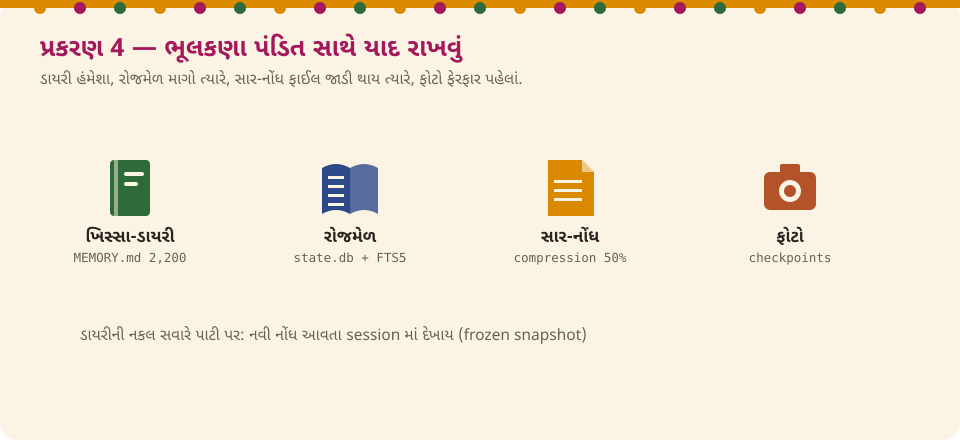

# પ્રકરણ 4 — યાદ: memory, sessions, compression

> **Level 4 · વાર્તાનો દિવસ 8–9.**
> આજનો પ્રશ્ન: **"શાસ્ત્રીજી બધું ભૂલી જાય છે. તો હર્ષ કેવી રીતે યાદ રાખે છે?"**
> જવાબ ત્રણ જુદી વસ્તુ છે, અને ત્રણેયનું કામ જુદું છે: ખિસ્સા-ડાયરી, રોજમેળ, અને સાર-નોંધ.
> પહેલાં: [પ્રકરણ 3](03-ojar-kabat-tools.md). આખો નકશો: [સમગ્ર નકશો](overview-samagra-naksho.md).



## 🎯 આ પ્રકરણ પછી તમે શું કરી શકશો

- **Memory**, **session history** અને **compression** — ત્રણ પ્રકારની "યાદ" — અલગ કરી, કઈ ક્યારે વપરાય તે કહી શકશો.
- `MEMORY.md` અને `USER.md` ની મર્યાદાઓ, અને "frozen snapshot" શા માટે bug નથી તે સમજાવી શકશો.
- `state.db` અને FTS5 search નું કામ કહી શકશો.
- Compression ના ચાર તબક્કા અને તેની સલામતી-શરતો ગણાવી શકશો.

## 🗺️ નકશો: ત્રણ પ્રકારની યાદ

| | ખિસ્સા-ડાયરી | રોજમેળ | સાર-નોંધ |
|---|---|---|---|
| **Hermes માં** | `MEMORY.md`, `USER.md` | `state.db` (SQLite + FTS5) | Context compression |
| **કદ** | બહુ નાનું (2,200 + 1,375 અક્ષર) | અમર્યાદ | ચાલુ ફાઈલ પૂરતું |
| **Model ક્યારે જુએ** | **હંમેશા** (પાટી પર) | **માગે ત્યારે** (`session_search`) | ચાલુ વાતચીતમાં |
| **કોણ લખે** | Agent, `memory` tool થી | આપમેળે, દરેક turn | આપમેળે, threshold પર |
| **દૃશ્ય** | 1, 2, 3 | 4 | 5, 6 |

અને ચોથી, જુદી જાતની યાદ: **files** ની (checkpoints, દૃશ્ય 7). પહેલી ત્રણ વાતચીતની યાદ છે; ચોથી કામની.

---

## દૃશ્ય 1 — "ડાયરીમાં લખ્યું, છતાં યાદ નથી": frozen snapshot

🎬 સોમવારે બપોરે ઈશા હર્ષને કહે છે: "યાદ રાખજે, પટેલ લગ્નના કેટરર જલારામ છે." હર્ષ ખિસ્સા-ડાયરીમાં લખે છે: "થઈ ગયું."

દસ મિનિટ પછી ઈશા કસોટી કરે છે. ફોન પર શાસ્ત્રીજીને **પાટી** વંચાય છે — અને પાટી પર ડાયરીની નકલ **સવારની** છે. તેમાં જલારામ નથી.

❓ "હર્ષ! તેં હમણાં જ લખ્યું હતું!"

નિખિલમામા: "ડાયરીમાં છે. પણ પાટી સવારે લખાઈ હતી, અને પાટી…"

"…દિવસભર અડાય નહીં." ઈશા પ્રકરણ 2 યાદ કરે છે.

💻 Memory ની બે files `~/.hermes/memories/` માં ([memory doc][doc-memory]) ✅:

| File | શું | મર્યાદા |
|---|---|---|
| `MEMORY.md` | Agent ની પોતાની નોંધ: environment, conventions, શીખેલી વાતો | 2,200 અક્ષર (~800 tokens) |
| `USER.md` | વપરાશકર્તાની profile: પસંદ, બોલવાની રીત, અપેક્ષા | 1,375 અક્ષર (~500 tokens) |

અને મુખ્ય વાક્ય ([link][doc-memory-frozen]) ✅:

> "**Frozen snapshot pattern:** The system prompt injection is captured once at session start and never changes mid-session. This is intentional — it preserves the LLM's prefix cache for performance. When the agent adds/removes memory entries during a session, the changes are persisted to disk immediately but won't appear in the system prompt until the next session starts. Tool responses always show the live state."

Code માં store પાસે **બે અલગ વસ્તુ** છે ([memory_tool_store.py][memory-snapshot]) ✅: જીવંત entries, અને `_system_prompt_snapshot` — "frozen at load time (prefix-cache stable)". Pાટી માટેનું function ફક્ત snapshot આપે છે ([link][memory-format]) ✅:

```python
# Repository code — tools/memory_tool_store.py
def format_for_system_prompt(self, target: str) -> Optional[str]:
    ...
    return self._system_prompt_snapshot.get(target, "") or None
```

**તો ચાલુ વાતચીતમાં agent ને કેવી રીતે ખબર પડે?** બે રસ્તે: (1) વાત **ફાઈલમાં જ છે** — તમે હમણાં કહ્યું, તે history માં છે; (2) `memory` tool નો response હંમેશા **live state** બતાવે છે.

🔬 **Expert નજર.** આ પુસ્તકની સૌથી સુંદર design વાત અહીં છે: **જે bug જેવું લાગે છે, તે invariant નું પરિણામ છે.** પ્રકરણ 2 નો નિયમ ("પાટી byte-stable") ન જાણનારને આ ભૂલ લાગે; જાણનારને તે **અનિવાર્ય** લાગે. કોઈ પણ system માં વિચિત્ર વર્તન જુઓ ત્યારે પૂછો: "આ કયા નિયમનું પરિણામ હોઈ શકે?" Guide તેને આ શબ્દોમાં મૂકે છે: "Before you call it a bug, verify the claim AND the intent… an absence can be load-bearing" ([link][agents-verify-intent]) ✅.

## દૃશ્ય 2 — ડાયરી ભરાઈ ગઈ: મર્યાદા એ લક્ષણ છે

🎬 મહિના પછી હર્ષની ખિસ્સા-ડાયરી ભરાઈ ગઈ. તે નવી નોંધ લખવા જાય છે; જગ્યા નથી. હર્ષ સ્મિતાબેન પાસે મોટી ડાયરી માગે છે.

સ્મિતાબેન: "ના. આ ડાયરી **દરેક ફોનમાં વંચાય છે**. મોટી ડાયરી એટલે દરેક ફોન મોંઘો. ભરાઈ ગઈ? તો **જૂની નોંધો ભેગી કર કે કાઢી નાખ**, પછી નવી લખ."

💻 Defaults ([config_defaults.py][memory-limits-default]) ✅:

```python
"memory_char_limit": 2200,   # ~800 tokens at 2.75 chars/token
"user_char_limit": 1375,     # ~500 tokens at 2.75 chars/token
```

Entries એક ખાસ ચિહ્નથી જુદી પડે છે ([link][memory-delim]) ✅:

```python
ENTRY_DELIMITER = "\n§\n"
```

અને ઉમેરતી વખતે મર્યાદા તપાસાય છે ([`add()`][memory-add]) ✅ — docstring: "Append a new entry. Returns error if it would exceed the char limit."

Docs સ્પષ્ટ કહે છે ([link][doc-memory]) ✅: memory **auto-compact થતી નથી**. લખાણ મર્યાદા ઓળંગે તો `memory` tool **error** આપે છે, "instead of silently dropping entries". પછી agent જાતે જગ્યા કરે છે: entries ભેગી કરે કે કાઢે, અને ફરી પ્રયત્ન કરે.

મર્યાદા **અક્ષરોમાં** છે, tokens માં નહીં. કેમ? Store ની પહેલી લીટીઓ: "budgets are in chars (model-independent)". Token ની ગણતરી model પ્રમાણે બદલાય; અક્ષર નહીં.

🔬 **Expert નજર.** અહીં બે નિર્ણય છે, અને બંને શીખવા જેવા:

1. **મર્યાદા ગુણવત્તા લાવે છે.** અમર્યાદ memory માં agent બધું લખે: "આજે મંગળવાર હતો." મર્યાદિત memory માં તેણે **પસંદ કરવું** પડે કે શું ખરેખર કાયમી છે. 2,200 અક્ષર એક કાગળની બાજુ જેટલા છે; એટલે જ તે કામના રહે છે.
2. **ચૂપચાપ કાઢવા કરતાં મોટેથી error.** System જાતે જૂની entries કાઢી નાખે, તો કઈ ગઈ તે કોઈને ખબર ન પડે. Error આપે, તો નિર્ણય **agent** લે — જેની પાસે context છે કે કઈ નોંધ હજી કામની છે. (દૃશ્ય 4 ના "ભૂલ પણ જવાબ છે" નું બીજું રૂપ.)

## દૃશ્ય 3 — ડાયરી ક્યારે કામ લાગે: session ની સીમા

🎬 Telegram પર પટેલ પરિવાર સાથેની વાતચીત **ત્રણ અઠવાડિયાંથી** એક જ ફાઈલમાં ચાલે છે. ફાઈલ જાડી, ફોન મોંઘા, અને હર્ષ ડાયરી ભાગ્યે જ ખોલે છે: બધું ફાઈલમાં જ છે.

નિખિલમામા: "ડાયરી **નવી ફાઈલ શરૂ થાય ત્યારે** કામ લાગે. એક જ ફાઈલ અનંત ચાલે, તો ડાયરીનો અર્થ જ નથી."

💻 Docs નો એક આખો વિભાગ: **"Memory Needs Session Boundaries"** ([link][doc-memory-boundaries]) ✅. Memory system session ના **અંત** ની આસપાસ બંધાયેલી છે: `MEMORY.md` / `USER.md` આવતા session માં સાર લઈ જાય, અને `session_search` બાકીની ખોટ પૂરે. એક જ session ની અંદર આ મશીનરીને ચાલવાનું કારણ જ નથી.

Messaging platforms પર chat જાણીજોઈને **એક સતત session** છે, જે restart અને reboot પછી પણ ટકે છે. એટલે docs ની સલાહ: કુદરતી સીમાઓ પર `/new` — કામ પૂરું થાય, વિષય બદલાય, દિવસ શરૂ થાય. CLI માં આ આપમેળે થાય છે; gateway પર સીમા **તમારે** બનાવવી પડે.

⚠️ **એક ઘર, એક agent.** Docs ચેતવે છે: બે agent processes ને એક જ Hermes home પર ન ચલાવો; બંને memory લખે અને એકબીજાની entries ભેળવે. બીજા agent ને પોતાની **profile** આપો.

🔬 **Expert નજર.** "Session ક્યારે પૂરું થાય?" સાદો પ્રશ્ન લાગે છે, પણ તે ત્રણ વસ્તુ નક્કી કરે છે: memory ક્યારે તાજી થાય, cache ક્યારે ફરી શરૂ થાય, અને ખર્ચ કેટલો વધે. **Lifecycle ની સીમાઓ** — શરૂઆત અને અંત — કોઈ પણ system માં સૌથી વધુ bugs ની જગ્યા છે, અને સૌથી વધુ design નિર્ણયોની.

## દૃશ્ય 4 — રોજમેળ: બધું લખાય, શબ્દથી શોધાય

🎬 પટેલ પરિવારના કાકા ફોન કરે છે: "ગયા મહિને આપણે થાળીની સંખ્યા નક્કી કરી હતી. કેટલી?" હર્ષની ડાયરીમાં નથી (બહુ ઝીણી વિગત). શાસ્ત્રીજીને યાદ નથી (કદી નથી હોતું).

હર્ષ **રોજમેળ** ખોલે છે: ઑફિસની દરેક વાતચીત, તારીખવાર. પણ 400 પાનાં! પાછળ **અનુક્રમણિકા** છે: "થાળી → પાનું 112, 118, 240". ત્રીસ સેકન્ડમાં જવાબ: "450; પછી 480 કરી."

💻 Hermes દરેક વાતચીત **SQLite** database માં રાખે છે — `get_hermes_home() / "state.db"`. તેમાં `sessions`, `messages`, અને શોધ માટે `messages_fts` જેવાં tables છે ([session storage doc][doc-storage-overview]) ✅.

પણ agent નો code SQLite ને સીધો અડતો નથી. વચ્ચે એક **interface** છે — રોજમેળનું "કાઉન્ટર" — જે કહે છે કે ચોપડામાંથી શું માગી શકાય ([backend.py][store-protocol]) ✅:

```python
# Repository code — persistence/core/backend.py
class PersistenceStore(Protocol):
    """One store handle bound to one profile: its repositories as named attributes beside these facts."""

    scope: ProfileScope
    read_only: bool
    ...
    sessions: SessionRepository
    messages: MessageRepository
    lineage: LineageRepository
    search: SessionSearch
    ...
```

અને આ interface નું એક ખરું રૂપ — SQLite backend ([_backend.py][sqlite-store]) ✅:

```python
# Repository code — persistence/sqlite/_backend.py
class SQLiteStore:
    """One store handle bound to one profile: its repositories, capability facts and awaitable view ``aio``."""
```

- **SQLite** = એક file માં આખો database; server નથી.
- **FTS5** = SQLite નું full-text search: શબ્દથી તરત શોધ (અનુક્રમણિકા). Table `messages_fts` નું schema હવે `persistence/sqlite/` માં છે ([_schema_ddl.py][sessiondb-fts]) ✅.
- **Protocol** = Python નો "કરાર": કયાં attributes અને methods હોવાં જોઈએ, અમલ કર્યા વગર. Code `store.messages`, `store.search` માગે છે; પાછળ SQLite છે કે બીજું કંઈ, તેને ખબર નથી.
- **Handle એક profile સાથે બંધાયેલું** ("bound to one profile"): પ્રકરણ 0 નું "રજિસ્ટરમાં જુઓ" અહીં type માં જ લખાયેલું છે.
- **WAL** = write-ahead log: ઘણા વાચકો, એક લેખક, એકબીજાને રોક્યા વગર.

Model આ સુધી `session_search` tool થી પહોંચે છે (core tool; agent-level, એટલે પ્રકરણ 1 ના inline table માં). README તેને "FTS5 session search with LLM summarization for cross-session recall" કહે છે ✅.

**Memory કે session search?**

| | Memory | Session search |
|---|---|---|
| ઉદાહરણ | "સ્મિતાબેનને ટૂંકા જવાબ ગમે" | "12 નવેમ્બરે થાળી 450 થી 480 કરી" |
| સ્વભાવ | કાયમી, વારંવાર જોઈએ | ઝીણું, ક્યારેક જોઈએ |
| ખર્ચ | **દરેક call** માં tokens | **માગો ત્યારે જ** |

🔬 **Expert નજર.** Storage ની રચના પોતે બીજી invariant નું ઉદાહરણ છે: **સાંકડી કમર** — interface (`PersistenceStore`) પાતળું અને સ્થિર, backend (`SQLiteStore`) તેની પાછળ. પ્રકરણ 0 નું "અગિયાર દિવસ પછી" દૃશ્ય બતાવે છે કે 2026 ના નવેમ્બરમાં આખું storage આ interface પાછળ ખસ્યું, અને agent loop નો code લગભગ અડ્યો નહીં. આ computer science નો જૂનો વિચાર છે: **cache અને disk**. નાનું, ઝડપી, મોંઘું (memory: હંમેશા context માં) અને મોટું, ધીમું, સસ્તું (database: માગો ત્યારે). દરેક સારી system બંને રાખે, અને મુખ્ય કળા એ નક્કી કરવાની છે કે **શું ક્યાં રહે**. અને એક સુરક્ષા વાત: sessions માં secrets અને અંગત વાતો હોય છે. Session storage doc એક guard વર્ણવે છે જે test process ને production `state.db` ખોલતાં **રોકે છે** — "a hard `RuntimeError`" — જેથી test નો નકલી ડેટા કદી જીવંત ઇતિહાસમાં ન ભળે.

## દૃશ્ય 5 — ફાઈલ ફોનમાં ન સમાય: compression

🎬 પટેલ લગ્નની ફાઈલ 300 પાનાંની થઈ ગઈ. શાસ્ત્રીજી એક ફોનમાં વધુમાં વધુ 400 પાનાં સાંભળી શકે. હજી થોડા દિવસ, અને ફોન **થશે જ નહીં**.

હર્ષ, અડધી મર્યાદા વટે કે તરત, ત્રણ કામ કરે છે:

1. **ડાયરીમાં જે લખવાનું બાકી છે તે લખી લે.**
2. વચ્ચેનાં પાનાંમાંથી **લાંબી યાદીઓ** (હોલના 40 ભાવપત્રક) કાઢીને ત્યાં લખે: "[જૂની વિગત, જગ્યા બચાવવા કાઢી]".
3. વચ્ચેનાં 250 પાનાંની એક **સાર-નોંધ** બનાવે: ધ્યેય, થયેલું કામ, લીધેલા નિર્ણય, હવે પછીનાં પગલાં. **પહેલાં પાનાં અને છેલ્લાં પાનાં અડ્યા વગર.**

💻 **Context compression.** Defaults ([config_defaults.py][compress-defaults], [doc][doc-compress-config]) ✅:

| Setting | Default | અર્થ |
|---|---|---|
| `compression.enabled` | `true` | — |
| `compression.threshold` | `0.50` | Context window ના આ ભાગે trigger |
| `compression.protect_last_n` | `20` | છેલ્લા આટલા સંદેશા ઓછામાં ઓછા સચવાય |
| `protect_first_n` | `3` (hardcoded) | System prompt + પહેલી આપ-લે |
| `compression.in_place` | `true` | એ જ session id પર compact |

⚠️ Doc ના table માં threshold સાથે એક ઝીણી નોંધ છે: 512K થી નાની context window માટે trigger નું તળિયું 0.75 છે. આ પુસ્તકે તે વર્તન ચલાવીને ચકાસ્યું નથી; તમારા model પર ખરો trigger `/usage` કે logs થી જુઓ.

**ચાર તબક્કા** ([Compression Algorithm][doc-compress-algo]) ✅:

| # | તબક્કો | ખર્ચ |
|---|---|---|
| 1 | **જૂનાં tool પરિણામ સાફ.** સુરક્ષિત પૂંછડીની બહારનાં, 200 અક્ષરથી લાંબાં tool results ને એક placeholder થી બદલો | **LLM call નહીં** |
| 2 | **સીમા નક્કી કરો.** માથું (પહેલા 3) + વચ્ચેનો ભાગ + પૂંછડી (token budget કે `protect_last_n`) | — |
| 3 | **Structured સાર.** વચ્ચેના ભાગનો સાર `auxiliary` model થી: Goal, Constraints & Preferences, Progress, Key Decisions, Relevant Files, Next Steps, Critical Context | એક LLM call |
| 4 | **ભેગું કરો.** માથું + સાર + પૂંછડી | — |

Placeholder નું ખરું લખાણ ([context_compressor.py][compress-placeholder]) ✅:

```python
_PRUNED_TOOL_PLACEHOLDER = "[Old tool output cleared to save context space]"
```

**બે સ્તર** ([agent/AGENTS.md][agent-flow-invariants] પછીનો Compression વિભાગ) ✅: agent નો `ContextCompressor` (50%) અને gateway ની session hygiene (85%).

🔬 **Expert નજર.** તબક્કા 1 ની ગોઠવણ જુઓ: **સસ્તું પહેલાં.** Tool results (file contents, terminal output) ફાઈલનો સૌથી જાડો અને સૌથી ઓછો કામનો ભાગ છે; model એ તે એક વાર વાંચીને નિર્ણય લઈ લીધો છે. તેને કાઢવામાં LLM call નથી. ઘણી વાર તબક્કો 1 એકલો પૂરતી જગ્યા કરી આપે. કોઈ પણ optimization માં આ ક્રમ રાખો: **મફત → સસ્તું → મોંઘું.**

## દૃશ્ય 6 — સાર-નોંધ બનાવતાં શું ન તૂટવું જોઈએ

🎬 પહેલી વાર હર્ષે સાર-નોંધ બનાવી ત્યારે ત્રણ ભૂલ કરી:

1. એક ચિઠ્ઠી ("હોલ તપાસ") સાર-નોંધમાં ગઈ, પણ તેનું **પરિણામ** પૂંછડીમાં રહી ગયું. શાસ્ત્રીજી: "આ જવાબ કયા પ્રશ્નનો?"
2. ડાયરીમાં લખવાની નોંધ લખ્યા **પહેલાં** પાનાં ફાડી નાખ્યાં.
3. જૂનાં પાનાં **બાળી નાખ્યાં**. પછી કાકાએ થાળીનો પ્રશ્ન પૂછ્યો.

💻 Hermes ના ત્રણ બચાવ:

**1. Tool જોડી કદી છૂટી ન પડે.** Doc ([Phase 2][doc-compress-boundaries]) ✅: "Boundaries are aligned to avoid splitting tool_call/tool_result groups." `_align_boundary_backward()` સળંગ tool results ની પાછળ ચાલીને parent assistant message શોધે છે. કારણ: પ્રકરણ 1 નો alternation નિયમ; જોડી વગરનું `tool` message provider reject કરે.

**2. પહેલાં memory.** Agent loop doc ✅: compression દરમિયાન પહેલું પગલું "Memory is flushed to disk first (preventing data loss)". અને compression પછી `invalidate_system_prompt()` memory ને disk પરથી **ફરી લોડ** કરે છે (પ્રકરણ 2, દૃશ્ય 4): એટલે compression એ એ ક્ષણ છે જ્યારે ચાલુ session ની નવી નોંધો પાટી પર પહોંચે.

**3. કંઈ ભૂંસાતું નથી.** `in_place: true` સાથે, compaction પહેલાંના turns એ જ session id નીચે **soft-archive** થાય છે (`active=0, compacted=1`) — "still searchable via `session_search` and recoverable, never deleted" ([doc][doc-compress-config]) ✅. સાર-નોંધ model ના **context** માટે છે; રોજમેળ પૂરો રહે છે.

એક ચોથો, skills માટે: compression માં `skill_view` નું પરિણામ સાફ થાય, તો તેની જગ્યાએ `[SKILL_PRUNED: … reload with skill_view(name='…')]` marker રહે, જેથી model ને ખબર રહે કે રીત **હવે તેની સામે નથી** અને ફરી લોડ કરવી પડશે ✅.

⚠️ **Summary model ની context window.** Doc ચેતવે છે: summary model ની window main model જેટલી કે મોટી હોવી જોઈએ, કારણ કે આખો વચ્ચેનો ભાગ **એક** call માં જાય છે.

🔬 **Expert નજર.** Compression **lossy** છે: માહિતી ખોવાય છે, અને તે એકમાત્ર જગ્યા છે જ્યાં Hermes જાણીજોઈને cache તોડે છે. એટલે તેની આસપાસ આટલી વાડ છે. Guide એક ખાસ નિષ્ફળતા પણ વર્ણવે છે: summary stream અટકી જાય, તો એક વાર fallback chain પર retry; ફરી અટકે, તો **deterministic fallback summary** — પણ "never a prune committed outside the lease/fence". અર્થ: અડધું compression કદી commit ન થાય. **જે operation ડેટા ગુમાવે, તે કાં પૂરું થાય, કાં બિલકુલ નહીં.**

## દૃશ્ય 7 — ફેરફાર પહેલાંનો ફોટો: checkpoints અને `/rollback`

🎬 હર્ષ પટેલ લગ્નની બેઠક-વ્યવસ્થાની file "સુધારે" છે, અને ભૂલથી અડધાં ટેબલ ભૂંસી નાખે છે. ત્રણ દિવસની મહેનત. ચાર યાદમાંથી એક પણ મદદ કરતી નથી: ડાયરીમાં ટેબલ નથી, રોજમેળમાં વાતચીત છે પણ file નથી, અને સાર-નોંધ તો વાતચીતની છે.

ઈશા: "આ ત્રણેય **વાતચીતની** યાદ છે. **Files** ની યાદ કોણ રાખે?"

નિખિલમામા: "હવેથી નિયમ: કોઈ કાગળ બદલતાં પહેલાં તેનો **ફોટોકોપી** બાજુની ફાઈલમાં. દરેક કામ દીઠ એક વાર પૂરતી."

💻 **Checkpoints** ([doc][doc-checkpoints]) ✅. Hermes, ફેરફાર પહેલાં, આપમેળે snapshot લે છે:

- **File tools** — `write_file` અને `patch` પહેલાં.
- **Destructive terminal commands** — `rm`, `mv`, `sed -i`, output redirects (`>`), `git reset`/`clean`/`checkout` વગેરે પહેલાં.
- **"at most one checkpoint per directory per turn"**.

Snapshots એક અલગ **shadow git store** માં જાય છે, `~/.hermes/checkpoints/store/` — "your real project `.git` is never touched". બધા projects એક store વહેંચે, એટલે git ની content-addressed objects ડુપ્લિકેટ બચાવે.

Code નું પ્રવેશદ્વાર ([agent/checkpoints/manager.py][checkpoint-ensure]) ✅:

```python
# Repository code — agent/checkpoints/manager.py
def ensure_checkpoint(self, working_dir: str, reason: str = "auto") -> bool:
    """Take a checkpoint if enabled and not already done this turn.

    Returns True if a checkpoint was taken, False otherwise.
    Never raises — all errors are silently logged. Never in a hosted scope: the working
    directory is the agent's sandbox's, not this host's.
```

પાછા વળવું ([commands][doc-checkpoints-cmds]) ✅ ⚠️:

| Command | કામ |
|---|---|
| `/rollback` | બધા checkpoints, ફેરફારના આંકડા સાથે |
| `/rollback <N>` | Checkpoint N પર પાછા; તમારા હાથના ફેરફાર રાખીને (અને છેલ્લો chat turn પણ undo) |
| `/rollback <N> --all` | પૂરું restore; હાથના ફેરફાર પણ જાય |
| `/rollback diff <N>` | Restore પહેલાં diff જુઓ |
| `/rollback <N> <file>` | ફક્ત એક file |

⚠️ **Default બંધ છે.** Docs: checkpoints "opt-in as of v2", કારણ કે મોટા ભાગના users `/rollback` વાપરતા નથી અને store નું કદ સમય જતાં વધે છે. ચાલુ કરવા: `hermes chat --checkpoints`, કે `config.yaml` માં `checkpoints.enabled: true`. મર્યાદાઓ: `max_snapshots: 20` (project દીઠ), `max_total_size_mb: 500`.

🔬 **Expert નજર.** બે ડિઝાઇન નિર્ણય ધ્યાનથી જુઓ. **"Never raises"**: snapshot નિષ્ફળ જાય તો મૂળ કામ અટકતું નથી. સલામતી-જાળ પોતે કામ તોડે તો લોકો તેને બંધ કરી દે (પ્રકરણ 3: "fixes that destroy the feature they secure"). **તમારું `.git` અડાતું નથી**: સલામતી-સાધન વપરાશકર્તાના પોતાના ઇતિહાસમાં commits ઉમેરે, તો તે મદદ નહીં, ગંદકી છે. અને "default off" એ પ્રામાણિક ખર્ચ-નિર્ણય છે: દરેક સારી સગવડની કિંમત છે, અને એ કિંમત કોણ ચૂકવે તે વપરાશકર્તા નક્કી કરે.

## Source map: આ ક્રમમાં ખોલો

1. [Memory doc — How It Works][doc-memory]
2. [memory_tool_store.py — `ENTRY_DELIMITER`][memory-delim]
3. [memory_tool_store.py — `add()`][memory-add]
4. [memory_tool_store.py — `format_for_system_prompt()`][memory-format]
5. [persistence/core/backend.py — `PersistenceStore`][store-protocol] અને [SQLiteStore][sqlite-store]
6. [Session storage doc — Hermes home][doc-session-home]
7. [Compression doc — Configuration][doc-compress-config]
8. [Compression doc — Algorithm][doc-compress-algo]
9. [Checkpoints doc][doc-checkpoints] અને [`ensure_checkpoint()`][checkpoint-ensure]

## 🧪 Lab 4 — ત્રણ યાદ, એક file માં

[`labs/04-memory/mini_memory.py`](../labs/04-memory/mini_memory.py): frozen snapshot સાથેનો memory store, ખરા SQLite FTS5 સાથેની session search, અને નાનો compressor.

**પહેલાં ધારો:**

1. `add()` સફળ થયા પછી તરત `snapshot` માં નવી નોંધ હશે?
2. મર્યાદા 120 અક્ષર, 62 વપરાયા, નવી નોંધ 70 અક્ષરની. શું થશે?
3. 17 સંદેશાની ફાઈલ, માથું 3, પૂંછડી 4: compression પછી કેટલા?

```bash
python3 labs/04-memory/mini_memory.py
```

અપેક્ષિત output 🧪 ([evidence](../evidence/04-mini-memory.out)):

```text
1) add            : {'success': True, 'usage': '62/120'}
   પાટી પરનો snapshot: 'સ્મિતાબેનને ટૂંકા જવાબ ગમે' ← નવી નોંધ આ session માં નથી દેખાતી
2) મર્યાદા ઉપર     : {'success': False, 'error': 'would exceed the limit (62/120 chars)'}
3) નવું session    : 'સ્મિતાબેનને ટૂંકા જવાબ ગમે\n§\nપટેલ લગ્ન: કેટરર જલારામ, 450 થાળી'
4) session_search 'plates':
      s1 | Patel wedding caterer is Jalaram, 450 plates
      s1 | Noted: Jalaram caterer, 450 plates for 12 December
      s3 | Change Patel wedding plates to 480
5) compression    : 17 સંદેશા → 8 | સાફ થયેલાં tool પરિણામ: 5
   roles          : s u a u a t u a (s=system u=user a=assistant t=tool)
```

**વાંચો:**

- Lines 1 અને 3: દૃશ્ય 1 આખું. `add` સફળ, snapshot જૂનો; નવા session માં `§` સાથે બંને entries.
- Line 2: error, ચૂપચાપ કાઢવું નહીં.
- Line 4: ત્રણ sessions માંથી "plates" શબ્દવાળી ત્રણ lines; `s2` (florist) નથી. આ ખરું FTS5 છે, Python ના `sqlite3` module માં.
- Line 5: 17 → 8 = માથું 3 + સાર 1 + પૂંછડી 4. Roles માં `a t` સાથે છે: tool જોડી છૂટી નથી પડી.

**પ્રયોગ.** `compress()` માં `protect_last=3` કરો. પૂંછડી હવે `tool` થી શરૂ થશે, તેના parent `assistant` વગર: દૃશ્ય 6 ની ભૂલ 1. Hermes નું `_align_boundary_backward()` બરાબર આને રોકે છે.

⚠️ Lab નો "સાર" એક fixed string છે; ખરા compression માં LLM call છે. Lab મર્યાદા 120 રાખે છે જેથી overflow સહેલાઈથી દેખાય; Hermes ની default 2,200.

## 🔮 આગાહી કસોટી

Agent turn 5 માં memory માં નોંધ ઉમેરે છે. Turn 30 માં compression થાય છે. Turn 31 ના system prompt માં એ નોંધ હશે? ([પરિશિષ્ટ D](../appendix/D-lab-solutions.md#ch4))

## 🩺 નિષ્ફળતા: "મેં કહ્યું હતું યાદ રાખજે; નવા session માં ભૂલી ગયો"

Memory doc માં આ ફરિયાદ માટે આખો troubleshooting વિભાગ છે. ક્રમસર:

1. **ખરેખર લખાયું હતું?** `~/.hermes/memories/MEMORY.md` ખોલો. Agent "યાદ રાખીશ" કહે, પણ `memory` tool **બોલાવે જ નહીં**, એવું બને; session માં tool call શોધો.
2. **સાચી profile?** બીજી profile ની memory અલગ છે (પ્રકરણ 0).
3. **મર્યાદા?** Tool એ error આપ્યો હશે અને agent એ જગ્યા કરી નહીં હોય.
4. **વિગત memory લાયક હતી?** ઝીણી વિગત (એક તારીખ, એક આંકડો) `session_search` નું કામ છે.

**પાઠ.** "યાદ" એક વસ્તુ નથી. ફરિયાદ આવે ત્યારે પહેલાં નક્કી કરો: **ત્રણમાંથી કઈ યાદ** ની વાત છે.

## ✅ સાર — ઈશાની નોટબુક

### સાત ઘટના, સાત નિયમ

| 🎬 ઘટના | 💻 નિયમ | તૂટે તો |
|---|---|---|
| લખ્યું, છતાં પાટી પર નથી | Memory = frozen snapshot | Cache તૂટે (પ્રકરણ 2) |
| ડાયરી ભરાઈ | અક્ષર-મર્યાદા; ભરાય તો error | Prompt ફૂલે; નકામી નોંધો |
| ત્રણ અઠવાડિયાંની એક ફાઈલ | Memory ને session સીમા જોઈએ (`/new`) | મોંઘું; memory નકામી |
| કાકાનો પ્રશ્ન | `state.db` + FTS5 + `session_search` | ઝીણી વિગતો કાયમ માટે ગઈ |
| 300 પાનાં | Compression: 50% પર, 4 તબક્કા | Context overflow |
| ત્રણ ભૂલ | Tool જોડી સાથે; પહેલાં memory; soft-archive | Provider reject; ડેટા ખોટ |
| અડધાં ટેબલ ભૂંસાયાં | Checkpoints: ફેરફાર પહેલાં shadow git snapshot; `/rollback` (opt-in) | Files ની ભૂલ પાછી ન વળે |

### નવા શબ્દો

Memory · frozen snapshot · `§` delimiter · session · SQLite · FTS5 · WAL · `session_search` · compression · threshold · protected tail · soft-archive · lossy.

### યાદ-ચાવીઓ

- **"ડાયરી નાની, ચોપડો મોટો, સાર વચ્ચેનો."**
- **"ડાયરી હંમેશા; ચોપડો માગો ત્યારે."**
- **"મફત → સસ્તું → મોંઘું."**

### સામાન્ય ગેરસમજો

| ગેરસમજ | હકીકત |
|---|---|
| "Memory માં લખ્યું એટલે તરત prompt માં." | આવતા session માં (કે compression પછી). |
| "Memory ભરાય તો જૂની entries જાતે જાય." | ના; error. Agent જાતે જગ્યા કરે. |
| "Compression પછી જૂના સંદેશા ગયા." | Context માંથી ગયા; `state.db` માં soft-archived, searchable. |

### પુનરાવર્તન કાર્ડ

| પ્રશ્ન | જવાબ |
|---|---|
| `MEMORY.md` / `USER.md` મર્યાદા? | 2,200 / 1,375 અક્ષર |
| Entries વચ્ચેનું ચિહ્ન? | `§` |
| Sessions ક્યાં? | `<hermes home>/state.db` |
| Compression default threshold? | 0.50 |
| Compression નો પહેલો તબક્કો? | જૂનાં tool results સાફ (LLM call વગર) |

## 🧠 Mastery check

1. Memory ની મર્યાદા tokens ને બદલે **અક્ષરોમાં** કેમ છે?
2. "Frozen snapshot" ને "bug" ગણીને કોઈ PR મોકલે જે દરેક `memory` write પછી system prompt ફરી બનાવે. Review માં તમે કઈ invariant ટાંકશો, અને Lab 2 નો કયો આંકડો બતાવશો?
3. Compression ના તબક્કા 1 માં LLM call કેમ નથી, અને તે તબક્કો **પહેલો** કેમ છે?
4. `in_place: true` માં compaction પછી `session_search` જૂનો સંદેશો શોધી શકે? કેમ?

જવાબો: [પરિશિષ્ટ D](../appendix/D-lab-solutions.md#ch4).

## 🎬 આગળ શું

આ અઠવાડિયે હર્ષે મહેમાન-યાદી અને કેટરરની ગણતરી મેળવવામાં આખી બપોર બગાડી: બે વાર ખોટી ગણતરી, ત્રીજી વાર સાચી. આવતા મહિને શાહ પરિવારની સગાઈ છે; એ જ કામ ફરી આવશે.

ઈશા: "ડાયરીમાં લખી લે કે કેવી રીતે કર્યું."

હર્ષ: "ડાયરીમાં 2,200 અક્ષર છે. આ રીત બે પાનાંની છે."

"તો બીજી કોઈ જગ્યા જોઈએ. **રીતો** માટે."

→ [પ્રકરણ 5 — રીત-પોથી: skills](05-reet-pothi-skills.md)

<!-- refs:start (generated by tools/citations.py) -->
[agent-flow-invariants]: https://github.com/NousResearch/hermes-agent/blob/93dd2a4efb0709ceac09969b85d306e768b53815/agent/AGENTS.md#L55-L78
[agents-verify-intent]: https://github.com/NousResearch/hermes-agent/blob/93dd2a4efb0709ceac09969b85d306e768b53815/AGENTS.md#L50-L52
[checkpoint-ensure]: https://github.com/NousResearch/hermes-agent/blob/93dd2a4efb0709ceac09969b85d306e768b53815/agent/checkpoints/manager.py#L1040-L1045
[compress-defaults]: https://github.com/NousResearch/hermes-agent/blob/93dd2a4efb0709ceac09969b85d306e768b53815/hermes_cli/config_defaults.py#L576-L590
[compress-placeholder]: https://github.com/NousResearch/hermes-agent/blob/93dd2a4efb0709ceac09969b85d306e768b53815/agent/context_compressor.py#L758
[doc-checkpoints]: https://github.com/NousResearch/hermes-agent/blob/93dd2a4efb0709ceac09969b85d306e768b53815/website/docs/user-guide/checkpoints-and-rollback.md#L27-L34
[doc-checkpoints-cmds]: https://github.com/NousResearch/hermes-agent/blob/93dd2a4efb0709ceac09969b85d306e768b53815/website/docs/user-guide/checkpoints-and-rollback.md#L42-L46
[doc-compress-algo]: https://github.com/NousResearch/hermes-agent/blob/93dd2a4efb0709ceac09969b85d306e768b53815/website/docs/developer-guide/context-compression-and-caching.md#L564-L575
[doc-compress-boundaries]: https://github.com/NousResearch/hermes-agent/blob/93dd2a4efb0709ceac09969b85d306e768b53815/website/docs/developer-guide/context-compression-and-caching.md#L598-L621
[doc-compress-config]: https://github.com/NousResearch/hermes-agent/blob/93dd2a4efb0709ceac09969b85d306e768b53815/website/docs/developer-guide/context-compression-and-caching.md#L289-L318
[doc-memory]: https://github.com/NousResearch/hermes-agent/blob/93dd2a4efb0709ceac09969b85d306e768b53815/website/docs/user-guide/features/memory.md#L11-L20
[doc-memory-boundaries]: https://github.com/NousResearch/hermes-agent/blob/93dd2a4efb0709ceac09969b85d306e768b53815/website/docs/user-guide/features/memory.md#L59-L66
[doc-memory-frozen]: https://github.com/NousResearch/hermes-agent/blob/93dd2a4efb0709ceac09969b85d306e768b53815/website/docs/user-guide/features/memory.md#L57
[doc-session-home]: https://github.com/NousResearch/hermes-agent/blob/93dd2a4efb0709ceac09969b85d306e768b53815/website/docs/developer-guide/session-storage.md#L16-L31
[doc-storage-overview]: https://github.com/NousResearch/hermes-agent/blob/93dd2a4efb0709ceac09969b85d306e768b53815/website/docs/developer-guide/session-storage.md#L122-L141
[memory-add]: https://github.com/NousResearch/hermes-agent/blob/93dd2a4efb0709ceac09969b85d306e768b53815/tools/memory_tool_store.py#L403-L414
[memory-delim]: https://github.com/NousResearch/hermes-agent/blob/93dd2a4efb0709ceac09969b85d306e768b53815/tools/memory_tool_store.py#L26
[memory-format]: https://github.com/NousResearch/hermes-agent/blob/93dd2a4efb0709ceac09969b85d306e768b53815/tools/memory_tool_store.py#L655-L658
[memory-limits-default]: https://github.com/NousResearch/hermes-agent/blob/93dd2a4efb0709ceac09969b85d306e768b53815/hermes_cli/config_defaults.py#L1269-L1270
[memory-snapshot]: https://github.com/NousResearch/hermes-agent/blob/93dd2a4efb0709ceac09969b85d306e768b53815/tools/memory_tool_store.py#L194
[sessiondb-fts]: https://github.com/NousResearch/hermes-agent/blob/93dd2a4efb0709ceac09969b85d306e768b53815/persistence/sqlite/_schema_ddl.py#L643
[sqlite-store]: https://github.com/NousResearch/hermes-agent/blob/93dd2a4efb0709ceac09969b85d306e768b53815/persistence/sqlite/_backend.py#L316-L317
[store-protocol]: https://github.com/NousResearch/hermes-agent/blob/93dd2a4efb0709ceac09969b85d306e768b53815/persistence/core/backend.py#L43-L58
<!-- refs:end -->
