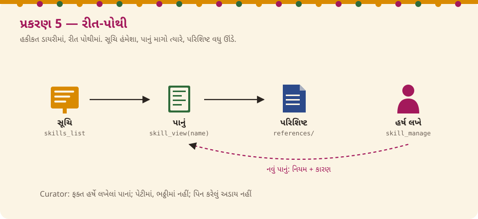

# પ્રકરણ 5 — રીત-પોથી: skills

> **Level 5 · વાર્તાનો દિવસ 10.**
> આજનો પ્રશ્ન: **"હર્ષ અનુભવમાંથી કેવી રીતે શીખે, જેથી એ જ ભૂલ બીજી વાર ન થાય?"**
> આ Hermes ની ઓળખ છે: README તેને "the self-improving AI agent" કહે છે, અને તેનું હૃદય skills છે.
> પહેલાં: [પ્રકરણ 4](04-yaad-memory-sessions.md). આખો નકશો: [સમગ્ર નકશો](overview-samagra-naksho.md).



## 🎯 આ પ્રકરણ પછી તમે શું કરી શકશો

- **Memory** (હકીકત) અને **skill** (રીત) નો તફાવત કહી, કઈ વાત ક્યાં જાય તે નક્કી કરી શકશો.
- **Progressive disclosure** ના ત્રણ સ્તર સમજાવી શકશો, અને તે context કેવી રીતે બચાવે છે તે કહી શકશો.
- Hermes ના authoring standards પાળતી `SKILL.md` લખી, તેને script થી તપાસી શકશો.
- **Curator** શું કરે અને શું **કદી ન કરે** તે કહી શકશો.

## 🗺️ નકશો

| # | દૃશ્ય | Hermes માં |
|---|---|---|
| 1 | એ જ ભૂલ બીજી વાર | Skill = procedural memory |
| 2 | પોથીની અનુક્રમણિકા | Progressive disclosure |
| 3 | એક પાનાનો નમૂનો | `SKILL.md` format અને standards |
| 4 | હર્ષ જાતે લખે | `skill_manage`; "lessons, not logs" |
| 5 | પોથીની સફાઈ | Curator |

---

## દૃશ્ય 1 — એ જ ભૂલ બીજી વાર: હકીકત અને રીત

🎬 ગયા અઠવાડિયે હર્ષે પટેલ લગ્નની મહેમાન-યાદી કેટરરની ગણતરી સાથે મેળવી. પહેલી વાર તેણે "કદાચ આવશું" કહેનારાને પણ ગણી લીધા: ગણતરી ખોટી. બીજી વાર પરિવાર દીઠ ગણ્યું, પ્રસંગ દીઠ નહીં: ફરી ખોટી. ત્રીજી વાર સાચી.

આજે શાહ પરિવારની સગાઈ માટે એ જ કામ આવ્યું. હર્ષ શાસ્ત્રીજીને ફોન કરે છે. શાસ્ત્રીજી ભૂલકણા છે; તે **ફરી એ જ બે ભૂલ** સૂચવે છે.

❓ "ડાયરીમાં લખ્યું હોત તો?"

"ડાયરીમાં **હકીકત** સમાય: 'કેટરર જલારામ'. આ **રીત** છે: સાત પગલાં, બે ચેતવણી. અને તે દરેક ફોનમાં વાંચવાની જરૂર નથી; ફક્ત **આ કામ આવે ત્યારે**."

💻 Hermes માં આ બે જુદી વસ્તુ છે ([skills doc][doc-skills-agent]) ✅:

> "memory stores small durable facts that should always be in context, while skills store longer procedures that should load only when relevant."

| | Memory | Skill |
|---|---|---|
| શું | હકીકત | રીત (procedure) |
| કદ | થોડા શબ્દો | એક-બે પાનાં, scripts સાથે |
| Context માં | હંમેશા | જરૂર પડે ત્યારે |
| ક્યાં | `memories/*.md` | `skills/<category>/<name>/SKILL.md` |
| Tool | `memory` | `skills_list`, `skill_view`, `skill_manage` |

Docs skills ને agent ની **"procedural memory"** કહે છે. અને README ની પહેલી લીટી: Hermes "creates skills from experience, improves them during use" ([link][readme-learning-loop]) ✅.

🔬 **Expert નજર.** Model ને "શીખવવા" ની બે રીત છે: તેનાં weights બદલો (training: મોંઘું, ધીમું), કે તેને **સાચા સમયે સાચું લખાણ** આપો. Skills બીજી રીત છે. Model એ જ રહે છે; જે બદલાય છે તે તેની સામેનો કાગળ. આ પ્રકરણ 3 ના footprint ladder નું બીજું પગથિયું પણ છે: જે "instructions + હાલનાં tools" થી થાય, તે માટે નવું tool નહીં, skill.

## દૃશ્ય 2 — પોથીની અનુક્રમણિકા: progressive disclosure

🎬 ઑફિસની રીત-પોથીમાં 90 રીતો છે. હર્ષ દરેક ફોનમાં આખી પોથી વાંચે તો? અશક્ય. એટલે પાટી પર ફક્ત **અનુક્રમણિકા** છે: દરેક રીતનું નામ અને એક લીટી.

શાસ્ત્રીજી અનુક્રમણિકા સાંભળીને કહે: "'મહેમાન-યાદી મેળવવી' વાળી રીત વાંચ." હર્ષ **તે એક પાનું** વાંચે. પાનામાં લખ્યું હોય "ભાવપત્રકનો નમૂનો પરિશિષ્ટમાં", તો જરૂર પડે ત્યારે **તે પરિશિષ્ટ**.

💻 ત્રણ સ્તર ([Progressive Disclosure][doc-skills-disclosure]) ✅:

```text
Level 0: skills_list()           → [{name, description, category}, ...]   (~3k tokens)
Level 1: skill_view(name)        → Full content + metadata       (varies)
Level 2: skill_view(name, path)  → Specific reference file       (varies)
```

Skills ની સૂચિ system prompt ના **volatile** થરની શરૂઆતમાં છે (પ્રકરણ 2, દૃશ્ય 3). આખી skill ફક્ત જરૂર પડે ત્યારે લોડ થાય, અને તે **tool result** તરીકે આવે, એટલે પાટી અડાતી નથી.

તમે જાતે પણ skill બોલાવી શકો: `/skill-name`. તે **user message** તરીકે inject થાય છે ([agent/AGENTS.md][agent-flow-invariants]) ✅ — ફરી એ જ નિયમ.

સૂચિની દરેક લીટી કિંમતી છે, એટલે તેના પર સીધી મર્યાદા છે ([skill_utils.py][skills-desc-limit]) ✅:

```python
SKILL_PROMPT_DESC_LIMIT = 60
```

60 અક્ષર: authoring standard અને default બંને. એક નવો setting, `skills.index_desc_limit` (60 થી 1024; [config_defaults.py][skills-index-desc-limit]) ✅, વપરાશકર્તાને **પોતાની** સૂચિ પહોળી કરવા દે છે; config ની comment tradeoff લખે છે: "wider routes better, costs tokens". પણ guide સ્પષ્ટ છે: તે વપરાશકર્તાનો index અને `skill_manage` budget પહોળાં કરે છે, "never this standard" ([skills/AGENTS.md][skills-agents]) ✅. Bundled skill લખો તો 60 જ.

🔬 **Expert નજર.** આ પ્રકરણ 4 નું "cache અને disk" ફરી છે, ત્રણ સ્તરે: સૂચિ (હંમેશા), skill (માગો ત્યારે), reference file (વધુ ઊંડે માગો ત્યારે). એક ઝીણો નિયમ તેની સાથે જાય છે: skill-loading tools પર `offset`/`limit` pagination **નથી** — "the agent must read a skill fully" ([link][skills-agents]) ✅. કેમ? અડધી વાંચેલી રીત ન વાંચેલી કરતાં ખરાબ છે: model પગલું 4 સુધી વાંચે, પગલું 6 ની ચેતવણી ચૂકે, અને આત્મવિશ્વાસથી ભૂલ કરે.

## દૃશ્ય 3 — એક પાનાનો નમૂનો: `SKILL.md`

🎬 ઈશા પહેલી રીત લખે છે. શીર્ષક: "મહેમાનોની યાદીને કેટરર સાથે મેળવવાની અત્યંત શક્તિશાળી અને સંપૂર્ણ રીત". નીચે: લાંબી વાર્તા કે તે દિવસે શું થયું હતું.

સ્મિતાબેન કાપી નાખે છે. "શીર્ષક એક લીટી; **શું કરે** તે કહે, વખાણ નહીં. અને પાનું હંમેશા એ જ ક્રમમાં: ક્યારે વાપરવી, શું જોઈએ, પગલાં, **ખાડા**, અને છેલ્લે: કેવી રીતે ખબર પડે કે બરાબર થયું."

💻 Skill એક folder છે, અને તેમાં `SKILL.md` ફરજિયાત ([format][doc-skills-format]) ✅:

```text
~/.hermes/skills/productivity/lagna-mehmaan-yadi/
├── SKILL.md          # મુખ્ય સૂચનાઓ (ફરજિયાત)
├── references/       # વધારાના docs
├── templates/        # output ના નમૂના
└── scripts/          # helper scripts
```

`SKILL.md` = YAML **frontmatter** (`---` વચ્ચે) + Markdown body. આ પુસ્તકની skill — [`labs/05-skills/lagna-mehmaan-yadi/SKILL.md`](../labs/05-skills/lagna-mehmaan-yadi/SKILL.md) — ની શરૂઆત (**book lab code**):

```markdown
---
name: lagna-mehmaan-yadi
description: Reconcile a wedding guest list with caterer counts.
version: 1.0.0
author: Isha (Shubhmangal Wedding Planners), Hermes Agent
license: MIT
metadata:
  hermes:
    tags: [wedding, guests, csv, reconciliation]
    category: productivity
---
```

**Authoring standards** — guide તેને "HARDLINE" કહે છે, અને એક test (`tests/skills/test_authoring_standards.py`) તેને લાગુ કરે છે ([link][skills-agents]) ✅. મુખ્ય:

| # | નિયમ | કેમ |
|---|---|---|
| 1 | `description` ≤ 60 અક્ષર, એક વાક્ય, પૂર્ણવિરામ; "powerful", "comprehensive", "seamless", "advanced" જેવા શબ્દ નહીં | સૂચિ ટૂંકી; model નું ધ્યાન વેરાય નહીં |
| 2 | Hermes ના **tools** નાં નામ લખો, shell utilities નાં નહીં: `grep` → `search_files`, `cat` → `read_file`, `sed` → `patch` | Model પાસે જે ઓજાર છે તેનું નામ |
| 3 | `platforms:` ખરા script imports પ્રમાણે | Windows પર POSIX-only skill ન દેખાય |
| 4 | `author` માં પહેલાં **માણસ**, પછી "Hermes Agent" | "credit the human, not the tool" |
| 5 | વિભાગોનો ક્રમ: When to Use → Prerequisites → How to Run → Quick Reference → Procedure → Pitfalls → Verification | દરેક skill એક જ આકારની |
| 6 | Parser જેવો logic model પાસે દર વખતે ન લખાવો; `scripts/` માં મૂકો | ઝડપી, સાચું, સસ્તું |

🔬 **Expert નજર.** છેલ્લા બે વિભાગ — **Pitfalls** અને **Verification** — skill ને સામાન્ય documentation થી જુદી પાડે છે. Pitfalls એ અનુભવ છે: "maybe ને ન ગણો". Verification એ agent ને **પોતાનું કામ તપાસવાની** રીત આપે છે. LLM સહેલાઈથી કહી દે છે "થઈ ગયું"; Verification તેને પૂછે છે "કેવી રીતે ખબર?" આ પુસ્તકનાં ✅ 🧪 ⚠️ નિશાન એ જ વિચાર છે.

## દૃશ્ય 4 — હર્ષ જાતે લખે: "lessons, not logs"

🎬 ત્રીજી વાર ગણતરી સાચી આવી કે તરત, હર્ષ **જાતે** પોથી ખોલીને નવું પાનું લખે છે. કોઈએ કહ્યું નથી.

પણ પહેલો મુસદ્દો આવો છે: "મંગળવારે બપોરે 3 વાગ્યે મેં પટેલની યાદી લીધી, પછી ઈશાબેને કહ્યું કે…"

નિખિલમામા: "આ **રોજનીશી** છે, રીત નથી. આવતા મહિને શાહ પરિવારના કામમાં 'મંગળવાર' અને 'ઈશાબેને કહ્યું' નકામાં છે. લખ: '`maybe` ને ન ગણો, **કારણ કે** કેટરરને confirmed થાળી દીઠ પૈસા અપાય છે.'"

💻 Agent `skill_manage` tool થી skills બનાવે, સુધારે, કાઢે. System prompt તેને non-trivial workflow નોંધવા કહે છે; docs પ્રમાણે વ્યવહારમાં ([link][doc-skills-agent]) ✅:

- multi-step workflow મળી જે ફરી કામ લાગે,
- errors કે dead ends પછી **કામ કરતો રસ્તો** મળ્યો,
- વપરાશકર્તાએ તેની રીત **સુધારી**.

અને લખાણનો નિયમ, docs ના શબ્દોમાં: skill "captures **lessons, not logs**": pitfall એ "a generalizable rule plus one clause of *why* (the mechanism)", જે પગલાને લાગુ પડે ત્યાં, એક વાર. "Incident narration, PR or issue numbers, dates, and quoted chat are not skill content; the rule has to stand without the story behind it."

`skill_manage` create અને patch વખતે એક **advisory linter** ચલાવે છે અને તેનાં તારણ tool result માં આપે છે: ફરી "ભૂલ પણ જવાબ છે".

**માણસનો કાબૂ.** Docs માં **write-approval gate** છે: skill ફેરફાર લાગુ થતાં પહેલાં તમારી મંજૂરી માગી શકાય ⚠️. અને background review session પછી skill ફેરફાર **સૂચવી** શકે.

⚠️ **વાર્તા અને ખરું વર્તન.** હર્ષ "જાતે" લખે છે તે model નો નિર્ણય છે, system prompt ની સૂચના પરથી. Model દર વખતે skill બનાવે તેની ખાતરી નથી; તે વર્તન છે, guarantee નથી.

🔬 **Expert નજર.** "Rule + one clause of why" ઊંડો નિયમ છે. **કારણ વગરનો નિયમ બરડ છે**: "maybe ને ન ગણો" જાણનાર model, "tentative" લખેલી નવી file જોઈને અટકી જશે. **કારણ** ("confirmed થાળી દીઠ પૈસા") જાણનાર model નવા કિસ્સામાં સાચું અનુમાન કરશે. આ પુસ્તકના દરેક દૃશ્યમાં 🔬 એ જ કારણે છે. અને તે સારા commit message, સારા code comment ("keep the WHY, cut the WHAT" — root `AGENTS.md`) અને સારા શિક્ષણનો પણ નિયમ છે.

## દૃશ્ય 5 — પોથીની સફાઈ: curator

🎬 છ મહિનામાં પોથી 300 પાનાંની થઈ ગઈ. અડધી રીતો એક વાર વપરાઈ અને પછી કદી નહીં. અનુક્રમણિકા લાંબી, દરેક ફોન મોંઘો.

સ્મિતાબેન મહિને એક વાર પોથી તપાસે છે. તેમના ત્રણ નિયમ:

1. "**હર્ષે લખેલાં** પાનાં જ તપાસું. છાપેલી મૂળ પોથી અને બહારથી મંગાવેલાં પાનાં અડું નહીં."
2. "લાંબા સમયથી ન વપરાયેલું પાનું **પેટીમાં** મૂકું. ફાડું કદી નહીં."
3. "જે પાના પર મેં **પિન** મારી છે, તેને કોઈ ન અડે."

💻 **Curator** ([skills/AGENTS.md][skills-curator]) ✅: background maintenance, જે agent-created skills નો વપરાશ track કરે અને જૂની skills auto-archive કરે.

- **Telemetry:** `~/.hermes/skills/.usage.json` — `use_count`, `view_count`, `patch_count`, `last_activity_at`, `state` (`active` / `stale` / `archived`), `pinned`.
- **CLI:** `hermes curator status|run|pause|resume|pin|unpin|archive|restore|prune|backup|rollback` ⚠️.
- **Config:** `curator:` — `enabled`, `interval_hours`, `min_idle_hours`, `stale_after_days`, `archive_after_days`, `backup.*`.

**Invariants** (શબ્દશઃ વિચાર):

1. ફક્ત `created_by: "agent"` skills ને અડે; bundled અને hub-installed "off-limits".
2. **"never deletes — archive is the maximum"**; archives `~/.hermes/skills/.archive/` માં, restorable.
3. Pinned skills દરેક auto-transition અને LLM review થી મુક્ત.
4. દરેક run પહેલાં tar.gz **backup** (`agent/curator_backup.py`).

⚠️ બે સ્રોત ક્યાંથી skills આવે: `skills/` (bundled, default ચાલુ) અને `optional-skills/` (મોકલાય, પણ **ચાલુ નથી**; `hermes skills install official/<category>/<skill>` થી).

🔬 **Expert નજર.** Curator એ **જાતે બદલાતા system** ની સલામતીનો નમૂનો છે. Agent પોતાની skills લખે અને કાઢે, એ શક્તિ છે અને જોખમ પણ. ચાર બચાવ જુઓ: **સીમિત અધિકાર** (ફક્ત પોતાનું લખેલું), **reversible** (archive, delete નહીં), **માણસનો veto** (pin), **backup** (rollback). કોઈ પણ automation જે તમારો ડેટા બદલે, તેને આ ચાર પ્રશ્ન પૂછો: શેને અડી શકે? પાછું વાળી શકાય? હું રોકી શકું? નકલ છે?

## Source map: આ ક્રમમાં ખોલો

1. [Skills doc — Progressive Disclosure][doc-skills-disclosure]
2. [Skills doc — SKILL.md Format][doc-skills-format]
3. [skills/AGENTS.md — Authoring standards][skills-agents]
4. [skill_utils.py — `SKILL_PROMPT_DESC_LIMIT`][skills-desc-limit]
5. [Skills doc — Agent-Managed Skills][doc-skills-agent]
6. [skills/AGENTS.md — Curator][skills-curator]

## 🧪 Lab 5 — તમારી પહેલી skill, અને તેની તપાસ

**ભાગ A — વાંચો.** [`SKILL.md`](../labs/05-skills/lagna-mehmaan-yadi/SKILL.md) ખોલો. Pitfalls વિભાગમાં બે નિયમ છે; દરેકમાં "કારણ" નો ભાગ શોધો.

**ભાગ B — તપાસો.** [`check_skill.py`](../labs/05-skills/check_skill.py) દૃશ્ય 3 ના table ના નિયમ 1, 2 અને 5 તપાસે છે, અને પછી skill ની એક **બગાડેલી નકલ** પર ફરી ચાલે છે.

**પહેલાં ધારો:** બગાડેલી નકલમાં description "A powerful and comprehensive skill that reconciles wedding guest lists with caterers" છે અને `read_file` ને બદલે `cat` લખ્યું છે. કેટલી ભૂલો પકડાશે?

```bash
python3 labs/05-skills/check_skill.py labs/05-skills/lagna-mehmaan-yadi/SKILL.md
```

અપેક્ષિત output 🧪 ([evidence](../evidence/05-check-skill.out)):

```text
description (51 અક્ષર): Reconcile a wedding guest list with caterer counts.
પરિણામ: બધું બરાબર ✅
બગાડેલી નકલ:
  ✗ description 84 અક્ષર છે (મર્યાદા 60)
  ✗ description પૂર્ણવિરામથી પૂરું નથી થતું
  ✗ marketing શબ્દ: 'powerful'
  ✗ marketing શબ્દ: 'comprehensive'
  ✗ shell utility `cat` નહીં, Hermes tool `read_file` લખો
```

**ભાગ C — Hermes માં** ⚠️ (ચલાવ્યું નથી): folder ને `~/.hermes/skills/productivity/` માં copy કરો, નવું session શરૂ કરો, અને `/lagna-mehmaan-yadi` લખો; અથવા fixtures ના paths આપીને પૂછો "મહેમાન-યાદી અને કેટરરની ગણતરી મળે છે?"

**પ્રયોગ.** તમારા પોતાના જીવનની એક રીત (દા.ત. "પરીક્ષાનું ટાઈમટેબલ બનાવવું") ની `SKILL.md` લખો અને checker ચલાવો. સૌથી અઘરો ભાગ કયો લાગ્યો? મોટા ભાગના લોકો માટે: **Verification**.

⚠️ `check_skill.py` પુસ્તકનું નાનું checker છે; Hermes નો ખરો test વધુ નિયમો તપાસે છે.

## 🔮 આગાહી કસોટી

Curator ચાલે છે. `~/.hermes/skills/` માં ત્રણ skills 120 દિવસથી વપરાઈ નથી: (a) bundled `github` skill, (b) agent એ બનાવેલી `old-report`, (c) agent એ બનાવેલી અને તમે pin કરેલી `tax-steps`. કઈ archive થઈ શકે? ([પરિશિષ્ટ D](../appendix/D-lab-solutions.md#ch5))

## 🩺 નિષ્ફળતા: "Skill install કરી, પણ agent ને તે દેખાતી નથી"

1. **ચાલુ વાતચીતમાં install કરી?** સૂચિ પાટી પર છે, અને પાટી સ્થિર છે. Docs: આગલા સંદેશા સાથે એક ટૂંકી નોંધ નવી skills નાં નામ લઈ જાય છે; પાટી પોતે compaction વખતે તાજી થાય ([link][doc-skills-disclosure]) ✅.
2. **Platform gate?** `platforms: [macos]` વાળી skill Linux પર દેખાય નહીં.
3. **Disabled?** `skills.disabled` માં નામ હોય તો `skill_view` ના પાડે.
4. **Optional skill?** `optional-skills/` ની skill install કર્યા વગર ચાલુ નથી.

**પાઠ.** ફરી પ્રકરણ 2: "દેખાતું નથી" નો પહેલો પ્રશ્ન — **આ માહિતી prompt ના કયા ભાગમાં છે, અને તે ક્યારે તાજો થાય છે?**

## ✅ સાર — ઈશાની નોટબુક

### પાંચ ઘટના, પાંચ નિયમ

| 🎬 ઘટના | 💻 નિયમ | તૂટે તો |
|---|---|---|
| એ જ ભૂલ બીજી વાર | Skill = procedural memory | દર વખતે શૂન્યથી |
| અનુક્રમણિકા | Progressive disclosure: સૂચિ → skill → reference | Context ભરાઈ જાય |
| "શક્તિશાળી અને સંપૂર્ણ" | Description ≤ 60; નિશ્ચિત વિભાગો | સૂચિ ફૂલે; skills અસમાન |
| રોજનીશી નહીં, રીત | "Lessons, not logs"; rule + why | Skill નવા કિસ્સામાં નકામી |
| પેટી અને પિન | Curator: agent-created જ; archive, delete નહીં; pin | Skills નો ઢગલો, કે ખોવાયેલું કામ |

### નવા શબ્દો

Skill · procedural memory · progressive disclosure · frontmatter · `skill_manage` · authoring standards · pitfall · verification · curator · archive · pin.

### યાદ-ચાવીઓ

- **"હકીકત ડાયરીમાં, રીત પોથીમાં."**
- **"સૂચિ – પાનું – પરિશિષ્ટ."**
- **"નિયમ + કારણ."**
- **"પેટીમાં, ભઠ્ઠીમાં નહીં."**

### સામાન્ય ગેરસમજો

| ગેરસમજ | હકીકત |
|---|---|
| "Skill એટલે plugin." | Skill = Markdown સૂચનાઓ (+ scripts). Plugin = Python code જે tools/hooks નોંધે (પ્રકરણ 7). |
| "બધી skills હંમેશા context માં છે." | ફક્ત સૂચિ; body માગો ત્યારે. |
| "Curator જૂની skills કાઢી નાખે." | Archive કરે; delete કદી નહીં; pin કરેલી અડે નહીં. |

### પુનરાવર્તન કાર્ડ

| પ્રશ્ન | જવાબ |
|---|---|
| Description ની મર્યાદા? | 60 અક્ષર |
| `SKILL.md` ના છેલ્લા બે વિભાગ? | Pitfalls, Verification |
| Agent skill કયા tool થી લખે? | `skill_manage` |
| Curator કઈ skills ને અડે? | `created_by: "agent"` |
| `/skill-name` કેવી રીતે inject થાય? | User message તરીકે |

## 🧠 Mastery check

1. "કેટરર જલારામ છે" અને "કેટરરની ગણતરી કેવી રીતે મેળવવી" — કયું memory, કયું skill? દરેક માટે **context ખર્ચ** નું કારણ આપો.
2. Skill-loading tools પર pagination કેમ નથી?
3. આ pitfall સુધારો: "12 નવેમ્બરે Desai પરિવારની entry ને લીધે ગણતરી ખોટી આવી હતી (issue #42)."
4. Curator ના ચાર બચાવ ગણાવો, અને દરેક કઈ નિષ્ફળતા રોકે છે તે કહો.

જવાબો: [પરિશિષ્ટ D](../appendix/D-lab-solutions.md#ch5).

## 🎬 આગળ શું

રાત્રે 11 વાગ્યે પટેલ પરિવારના કાકા **WhatsApp** પર લખે છે: "હોલનું સરનામું મોકલો." સવારે 8 વાગ્યે કેટરરને **રોજ** યાદ અપાવવાનું છે. અને લગ્નના આગલા દિવસે ત્રણ કામ **એકસાથે** કરવાનાં છે.

હર્ષ એક છે. તેનું ટેબલ ઑફિસમાં છે. ઑફિસ રાત્રે બંધ છે.

"તો એક હર્ષ અનેક જગ્યાએ, અનેક સમયે, અનેક હાથે કેવી રીતે?"

→ [પ્રકરણ 6 — બારીઓ, ઘડિયાળ અને શિખાઉ](06-bario-ghadiyal-shikhau.md)

<!-- refs:start (generated by tools/citations.py) -->
[agent-flow-invariants]: https://github.com/NousResearch/hermes-agent/blob/93dd2a4efb0709ceac09969b85d306e768b53815/agent/AGENTS.md#L55-L78
[doc-skills-agent]: https://github.com/NousResearch/hermes-agent/blob/93dd2a4efb0709ceac09969b85d306e768b53815/website/docs/user-guide/features/skills.md#L607-L626
[doc-skills-disclosure]: https://github.com/NousResearch/hermes-agent/blob/93dd2a4efb0709ceac09969b85d306e768b53815/website/docs/user-guide/features/skills.md#L173-L194
[doc-skills-format]: https://github.com/NousResearch/hermes-agent/blob/93dd2a4efb0709ceac09969b85d306e768b53815/website/docs/user-guide/features/skills.md#L195-L230
[readme-learning-loop]: https://github.com/NousResearch/hermes-agent/blob/93dd2a4efb0709ceac09969b85d306e768b53815/README.md#L19
[skills-agents]: https://github.com/NousResearch/hermes-agent/blob/93dd2a4efb0709ceac09969b85d306e768b53815/skills/AGENTS.md#L24-L35
[skills-curator]: https://github.com/NousResearch/hermes-agent/blob/93dd2a4efb0709ceac09969b85d306e768b53815/skills/AGENTS.md#L64-L81
[skills-desc-limit]: https://github.com/NousResearch/hermes-agent/blob/93dd2a4efb0709ceac09969b85d306e768b53815/agent/skill_utils.py#L846
[skills-index-desc-limit]: https://github.com/NousResearch/hermes-agent/blob/93dd2a4efb0709ceac09969b85d306e768b53815/hermes_cli/config_defaults.py#L1400
<!-- refs:end -->
