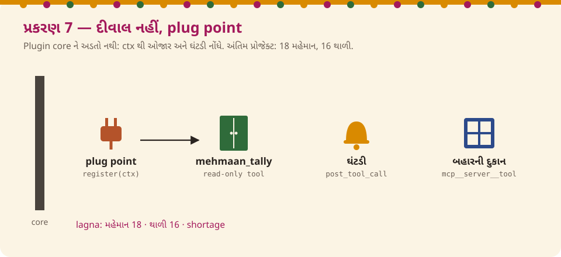

# પ્રકરણ 7 — પોતાનું ઓજાર અને mastery

> **Level 7 · વાર્તાનો દિવસ 13–14.**
> આજનો પ્રશ્ન: **"Hermes ને તોડ્યા વગર કેવી રીતે વિસ્તારવું?"**
> ઈશા પોતાનું પહેલું plugin બનાવે છે, પટેલ પરિવારનો ખરો પ્રશ્ન ઉકેલે છે, અને શીખે છે કે maintainer ની જેમ કેવી રીતે વિચારવું.
> પહેલાં: [પ્રકરણ 6](06-bario-ghadiyal-shikhau.md). આખો નકશો: [સમગ્ર નકશો](overview-samagra-naksho.md).



## 🎯 આ પ્રકરણ પછી તમે શું કરી શકશો

- Hermes plugin ની ચાર files લખી, tool અને hook નોંધી શકશો.
- Handler ના ચાર નિયમ પાળતો, test થયેલો tool બનાવી શકશો.
- **Hooks**, **MCP**, **fallback providers** અને **profiles** ક્યારે વાપરવાં તે કહી શકશો.
- Hermes ની **contribution rubric** પ્રમાણે કઈ PR સ્વીકારાય અને કઈ નહીં તે આંકી શકશો.
- આખું પુસ્તક "expert ની દસ ટેવો" માં સમેટી શકશો.

## 🗺️ નકશો

| # | દૃશ્ય | Hermes માં |
|---|---|---|
| 1 | દીવાલ તોડવા માગતો કારીગર | "Plugins never touch core" |
| 2 | કારીગરનું ઓળખપત્ર અને ઓજાર | `plugin.yaml`, `register(ctx)`, handler નિયમો |
| 3 | ચૂપચાપ જોનાર | Hooks |
| 4 | બીજા પંડિત, બીજી શાખા, બહારની દુકાન | Fallback, profiles, MCP |
| 5 | કઈ અરજી મંજૂર થાય | Contribution rubric |
| 6 | અંતિમ પ્રોજેક્ટ | પટેલ લગ્ન: મહેમાન ↔ થાળી |
| — | ઉપસંહાર | Expert ની દસ ટેવો |

---

## દૃશ્ય 1 — દીવાલ તોડવા માગતો કારીગર

🎬 એક લાઈટવાળો કારીગર ઑફિસમાં નવી લાઈટ લગાવવા આવે છે. તે કહે છે: "વાયર લઈ જવા આ **દીવાલ તોડવી** પડશે." સ્મિતાબેન ના પાડે છે.

"ઑફિસમાં દરેક ઓરડે **plug point** છે. તેમાં જોડ. Plug point ઓછા પડે, તો મને કહે: હું **બધા કારીગરો માટે** નવો plug point નખાવીશ. પણ દીવાલ તારા એકલા માટે નહીં તૂટે."

💻 Plugins guide નું પહેલું શીર્ષક ([plugins/AGENTS.md][plugins-never-core]) ✅: **"Plugins never touch core."**

> "A plugin MUST NOT modify `run_agent.py`, `cli.py`, `gateway/run.py`, `hermes_cli/main.py`, etc. If it needs a capability the framework lacks, widen the **generic** plugin surface (new hook, new ctx method) and have the plugin use it — never hardcode plugin-specific logic into core."

- **Plug point** = plugin API: `ctx` object, hooks, ABCs.
- **દીવાલ** = core files.

અને પૂરક નિયમ root guide માં: "core never imports a specific bundled plugin, and plugins use only the published plugin API"; `scripts/boundary_lint.py` નવા crossings પર test suite fail કરે છે ✅.

Plugin ત્રણ જગ્યાએથી મળે ([architecture][doc-architecture] ના Plugin System વિભાગમાં) ✅: `~/.hermes/plugins/` (user), `.hermes/plugins/` (project), અને pip entry points.

🔬 **Expert નજર.** Guide એક ખરો દાખલો આપે છે: એક PR એ `main.py` માંથી એક plugin માટેની 95 lines ની hardcoded argparse કાઢી. દરેક "ફક્ત આ એક plugin માટે" નો અપવાદ core ને થોડો મોટો અને થોડો બરડ બનાવે. સો plugins, સો અપવાદ → core કોઈ સમજી ન શકે. **Extension point ની કિંમત શિસ્તમાં છે**: જે ક્ષણે એક plugin ને પાછલા દરવાજેથી આવવા દો, plug point નો અર્થ ખતમ. અને ઉલટું પણ: "A hook with no concrete consumer is speculative infrastructure and is rejected" — કોઈ વાપરનાર વગરનો plug point પણ નહીં.

## દૃશ્ય 2 — કારીગરનું ઓળખપત્ર અને ઓજાર: plugin ની ચાર files

🎬 ઈશા "મહેમાન-ગણતરી" ઓજાર બનાવે છે. સ્મિતાબેન ચાર વસ્તુ માગે છે:

1. **ઓળખપત્ર**: નામ, શું લાવ્યા છો.
2. **ચિઠ્ઠી**: ઓજાર શું કરે, શું જોઈએ (શાસ્ત્રીજી માટે).
3. **ઓજાર પોતે**.
4. **નોંધણી**: કબાટમાં કયા ખાને.

💻 Plugin = એક folder, ચાર files ([plugin guide][doc-plugin-guide]) ✅. આ પુસ્તકનું plugin: [`labs/07-plugin/mehmaan-tally/`](../labs/07-plugin/mehmaan-tally/).

**1. `plugin.yaml` — manifest** (book lab code):

```yaml
name: mehmaan-tally
version: 1.0.0
description: Reconcile a wedding RSVP list with the caterer's plate count (read-only).
author: Isha (Shubhmangal Wedding Planners)
provides_tools:
  - mehmaan_tally
provides_hooks:
  - post_tool_call
```

Guide ની ઝીણી વાત: user-installed plugin માં `provides_tools` **નક્કી નથી કરતું** કે tools લોડ થશે; plugin enable થાય એટલે `register()` જે નોંધે તે બધું મળે. પણ `hermes plugins validate` "declared tools" check માં fail કરે છે જો નોંધાયેલાં tools યાદી સાથે ન મળે ✅.

**2. `schemas.py`** — model જે વાંચે (પ્રકરણ 3, દૃશ્ય 1). Description માં "Read-only: never edits either file" અને "Use it when the user asks whether…" બંને છે: **શું** અને **ક્યારે**.

**3. `tools.py` — handler.** ચાર નિયમ ([Key rules for handlers][doc-plugin-handlers]) ✅:

| # | નિયમ | આપણા code માં |
|---|---|---|
| 1 | Signature: `def handler(args: dict, **kwargs) -> str` | `def mehmaan_tally(args: dict, **kwargs) -> str:` |
| 2 | હંમેશા JSON string | `return json.dumps({...})` |
| 3 | **Never raise** | `except (OSError, KeyError, ValueError) as e: return json.dumps({"error": ...})` |
| 4 | `**kwargs` સ્વીકારો | Hermes `task_id`, `session_id`, `conversation_id`… આપે |

**4. `__init__.py` — registration** (book lab code):

```python
def register(ctx):
    ctx.register_tool(name="mehmaan_tally", toolset="mehmaan", schema=schemas.MEHMAAN_TALLY,
                      handler=tools.mehmaan_tally, emoji="🧮")
    ctx.register_hook("post_tool_call", _on_post_tool_call)
```

`ctx.register_tool()` ની ખરી signature ([plugins_context.py][plugin-register-tool]) ✅: `name, toolset, schema, handler, check_fn, requires_env, is_async, description, emoji, override`. અંદરથી તે પ્રકરણ 3 નું એ જ `registry.register()` બોલાવે છે, plugin ના scope સાથે.

Guide પ્રમાણે `register()` ([link][doc-plugin-register]) ✅: startup વખતે બરાબર એક વાર બોલાવાય; તે crash થાય તો "the plugin is disabled but Hermes continues fine".

**Built-in tool ને બદલવું?** `override=True` માટે operator ની opt-in જોઈએ; નહીં તો "any enabled plugin could silently replace a privileged built-in like `write_file`" (code ની comment) ✅.

**ચકાસણી** ⚠️ (ચલાવ્યું નથી) ([Plugin Doctor][doc-plugin-doctor]) ✅:

```bash
hermes plugins doctor labs/07-plugin/mehmaan-tally --ci
```

Doctor કામચલાઉ `HERMES_HOME` વાપરે છે અને એ જ discovery, manifest parser અને `register(ctx)` ચલાવે છે જે Hermes પોતે વાપરે. Guide ની પ્રામાણિક ચેતવણી: "This is not a sandbox" — plugin code તમારા permissions સાથે ચાલે છે.

🔬 **Expert નજર.** આ ઓજાર **read-only** કેમ? કારણ કે read-only tool માં સૌથી ખરાબ પરિણામ "ખોટો જવાબ" છે; write tool માં "ખોવાયેલો ડેટા". પહેલું version હંમેશા સૌથી નાના અધિકાર સાથે બનાવો. અને plugin guide ની બીજી ચેતવણી યાદ રાખો: capabilities "consent + audit, **not a sandbox**". Plugin install કરવું = તેના લેખક પર ભરોસો. એટલે catalog માં દરેક entry પર 40-hex SHA pin ફરજિયાત છે (પ્રકરણ 0, દૃશ્ય 4: એ દિવસનો ફોટો).

## દૃશ્ય 3 — ચૂપચાપ જોનાર: hooks

🎬 સ્મિતાબેન જાણવા માગે છે કે નવું ઓજાર કેટલી વાર વપરાય છે. ઈશા કબાટના દરવાજે એક **ઘંટડી** લગાવે છે: કોઈ પણ ઓજાર પાછું મુકાય, ઘંટડી વાગે, ઈશા નોંધે. ઘંટડી કામ **રોકતી નથી**; તૂટી જાય તો પણ કબાટ ખૂલે.

💻 **Hook** = lifecycle ની એક ક્ષણ, જ્યાં plugin નું function બોલાવાય ([Hook reference][doc-plugin-hooks]) ✅:

| Hook | ક્યારે | પરિણામ |
|---|---|---|
| `pre_tool_call` | Tool ચાલે તે પહેલાં | `{"action": "block", "message": …}` આપી **રોકી શકે** |
| `post_tool_call` | Tool પાછું આવે પછી | Ignored (observer) |
| `pre_llm_call` | Turn દીઠ એક વાર, loop પહેલાં | Context ઉમેરી શકે કે turn block કરી શકે |
| `post_llm_call` | Turn દીઠ એક વાર, loop પછી | — |
| `on_session_start` / `on_session_end` | Session ની સીમાઓ | Ignored |
| `post_compaction` | Compaction commit થયા પછી | Ignored |

આપણો hook (book lab code):

```python
def _on_post_tool_call(tool_name, args, result, task_id, **kwargs):
    """Hook: દરેક tool call પછી ચાલે (ફક્ત આપણા tool માટે નહીં). Observer: કંઈ બદલતો નથી."""
    if tool_name in _calls:
        _calls[tool_name] += 1
```

બે નિયમ guide માંથી: બધા callbacks `**kwargs` સ્વીકારે (forward compatibility), અને "If a hook callback crashes, it's logged and skipped. Other hooks and the agent continue normally."

🔬 **Expert નજર.** `pre_llm_call` context **ક્યાં** ઉમેરે છે? System prompt માં નહીં — તમે હવે જાણો છો કેમ. અને guide auxiliary calls (compression, title, vision) માટે **અલગ** hooks રાખે છે (`pre_auxiliary_call`), કારણ કે main-loop ના `pre/post_api_request` events aux calls માટે "must NOT fire". ફરક કેમ? Observer plugin (દા.ત. ખર્ચ ગણનાર) બંનેને ભેળવે તો main વાતચીતના આંકડા ખોટા આવે. **Event નું નામ એક વચન છે**: તે શું છે, અને શું નથી.

## દૃશ્ય 4 — બીજા પંડિત, બીજી શાખા, બહારની દુકાન

🎬 લગ્નના આગલા દિવસે ત્રણ વાત એકસાથે બને છે:

1. શાસ્ત્રીજીનો ફોન **લાગતો નથી**. હર્ષ યાદીમાંના **બીજા પંડિત** ને ફોન કરે છે. તે પણ વિદ્વાન, પણ તેમણે આજનો એક પણ ફોન સાંભળ્યો નથી: **આખી ફાઈલ પૂરા ભાવે**.
2. સુરતની શાખાનો માણસ વડોદરાની ડાયરી માગે છે. "ના. **દરેક શાખાની પોતાની**."
3. ફૂલવાળાની દુકાન પોતાનું ભાવપત્રક રાખે છે. હર્ષ તે દુકાનની **બારી** પર પૂછે છે; ભાવપત્રક ઑફિસમાં લાવતો નથી.

💻 ત્રણ features, એક-એક ફકરામાં:

**1. Fallback providers** ([Fallback Model][doc-loop-fallback]) ✅. Primary model fail થાય (429 rate limit, 5xx, 401/403) → config ની `fallback_providers` યાદી ક્રમમાં અજમાવાય; સફળ થાય તે સાથે વાતચીત ચાલુ. Auxiliary tasks (vision, compression, title) ની પોતાની fallback chains છે. **કિંમત** (પ્રકરણ 2): "Model identity is part of the cache key" — fallback પછીનો request શૂન્ય cache સાથે. Reliability મફત નથી.

**2. Profiles** (પ્રકરણ 0). દરેક profile = અલગ `HERMES_HOME`: config, `.env`, memory, sessions, skills, gateway. Design principle "Profile isolation" ✅. Guide: "profiles are islands on purpose" — એટલે "profile A ની memory B માં કેમ નથી?" bug નથી.

**3. MCP** (Model Context Protocol) — બહારની દુકાનની બારી. ફૂલવાળો પોતાનું ભાવપત્રક ઑફિસમાં નથી મોકલતો; તે પોતાની **બારી** ખોલે છે, અને હર્ષ ત્યાં પૂછે છે. MCP server એ જ છે: બીજું program, જે પોતાનાં tools એક સામાન્ય protocol પર આપે છે. Hermes માં તે `config.yaml` માં જોડાય છે ([MCP quick start][doc-mcp-quickstart]) ✅ ⚠️:

```yaml
mcp_servers:
  filesystem:
    command: "npx"
    args: ["-y", "@modelcontextprotocol/server-filesystem", "/home/user/projects"]
```

Server નાં tools registry માં **prefix** સાથે નોંધાય છે, જેથી built-in નામો સાથે ન અથડાય. Code ([mcp_tool_schema.py][mcp-prefix]) ✅:

```python
# Repository code — tools/mcp_tool_schema.py
def mcp_prefixed_tool_name(server_name: str, tool_name: str) -> str:
    """Registry/wire name: ``mcp__<sanitizedServer>__<sanitizedTool>``, clamped to 64 chars with a
    stable hash suffix when the natural name is longer."""
```

⚠️ **ચોથો docs-vs-code ફરક.** MCP user doc ([link][doc-mcp-registers]) નામ `mcp_<server_name>_<tool_name>` (એક underscore) બતાવે છે, ઉદાહરણ `mcp_github_create_issue`. Code બે underscore વાપરે છે: `mcp__github__create_issue`. Plugin guide code સાથે સહમત છે. 64 અક્ષરની મર્યાદા providers ની છે; લાંબા નામને stable hash suffix મળે છે.

**સુરક્ષા.** Footprint ladder (પ્રકરણ 3) માં MCP પાંચમું પગથિયું છે. MCP subprocesses ને **filtered environment** મળે છે (આઠ સ્તરોમાંનું #5), અને `trust: untrusted` server ના write-capable calls મંજૂરી માગે છે. Catalog માંથી install કરવું એટલે manifest જે કહે તે ચલાવવું: `git clone`, bootstrap commands, અને server નો પોતાનો code. Docs: Nous એ દરેક entry review કરી છે, "**but you should still read the manifest before installing**" ([trust model][doc-mcp-trust]) ✅. ઘણાં MCP servers હોય ત્યારે તેમનાં schemas Tool Search ની પેટીમાં જાય છે (પ્રકરણ 3, દૃશ્ય 8).

Local model પણ એક provider છે ([local models doc][doc-local-models]) ✅ ⚠️:

```yaml
providers:
  llamacpp:
    base_url: http://127.0.0.1:8081/v1
    model: my-model
```

🔬 **Expert નજર.** ત્રણેયમાં એક જ registry નમૂનો છે, અને architecture doc તેને principle તરીકે લખે છે: "Loose coupling — Optional subsystems … use registry patterns and check_fn gating, not hard dependencies." Provider, platform, memory backend, tool: દરેક **નામથી નોંધાય** અને **નામથી શોધાય**. Core કોઈને નામથી ઓળખતું નથી. જ્યારે તમે કોઈ નવા codebase માં આ નમૂનો જુઓ (registry + check + dispatch), ત્યારે તમે તેની અડધી architecture સમજી ગયા.

## દૃશ્ય 5 — કઈ અરજી મંજૂર થાય: contribution rubric

🎬 ઈશાને ઓજાર એટલું ગમ્યું કે તે સ્મિતાબેનને કહે છે: "આ ઑફિસના **મૂળ કબાટ** માં મૂકી દઈએ! બધી શાખાને મળે."

સ્મિતાબેન: "ઓજાર સારું છે. જવાબ **ના**. મૂળ કબાટ દરેક ફોનમાં વંચાય; સુરત શાખા લગ્ન કરાવતી જ નથી. તારું ઓજાર **તારા થેલામાં** સરસ છે."

ઈશા નિરાશ થાય છે. નિખિલમામા: "ના એ અપમાન નથી. એ **architecture** છે."

💻 Root `AGENTS.md` માં **Contribution rubric** છે, અને તેનો એક વિભાગ અસામાન્ય રીતે પ્રામાણિક છે ([link][agents-rejected]) ✅ — **"Rejected even when well-built"**:

| Reject | કયો નિયમ (પ્રકરણ) |
|---|---|
| Concrete consumer વગરના hooks | દૃશ્ય 1 |
| Non-secret config માટે નવા `HERMES_*` env vars | `.env` = secrets (0) |
| નવું core tool જ્યારે terminal + file કે skill ચાલે | Narrow waist (3) |
| Instructional tools પર `offset`/`limit` pagination | Skill પૂરી વંચાય (5) |
| "fixes" that destroy the feature they secure | સુરક્ષા જે ઓજારને મારે (3) |
| Opt-in વગર outbound telemetry | — |
| Change-detector tests | નીચે |
| Core files ને અડતાં plugins | દૃશ્ય 1 |
| Core tree માં third-party products | દૃશ્ય 1 |

**Wanted:** ખરા bug fixes ("repro on `main`, the exact line, the whole class incl. sibling paths"); કિનારા પર પહોંચ (adapters, providers, models); god-file → module refactors; behaviour-contract tests.

**Tests વિશે** ([link][agents-tests-rule]) ✅: હંમેશા `scripts/run_tests.sh`, કદી bare `pytest` નહીં; "behaviour contracts, never change-detectors or source-reading tests"; tests કદી `~/.hermes/` માં લખે નહીં. અને દરેક fix સાથે 1–2 invariant tests, "proven red on the base": fix **વગર** test fail થવો જોઈએ.

**"Before you call it a bug"** ([link][agents-verify-intent]) ✅: દાવો **અને ઇરાદો** બંને ચકાસો (`git log -p -S "<symbol>"`): "the isolation is often the design (profiles are islands on purpose), an absence can be load-bearing, and a fix that cannot point to the line where the bug manifests has an unverified premise."

🔬 **Expert નજર.** **Change-detector test** = test જે code **કેવો લખાયો છે** તે તપાસે (દા.ત. prompt નો આખો text snapshot), **શું કરે છે** તે નહીં. તે દરેક refactor પર fail થાય, અને ખરી bug પર કદી નહીં. **Behaviour-contract test** વચન તપાસે: "compression પછી પણ tool જોડી સાથે રહે", "system prompt વાતચીત દરમિયાન byte-stable રહે". Agent guide: "Assert message-shape invariants (alternation, byte-stable system prompt) rather than snapshotting prompt text." આ પુસ્તકની દરેક lab નો છેલ્લો assert આ જ પ્રકારનો છે.

અને "proven red on the base": **જે test કદી fail થતો જોયો નથી, તે test છે તેની ખાતરી નથી.**

## દૃશ્ય 6 — અંતિમ પ્રોજેક્ટ: પટેલ લગ્ન, મહેમાન ↔ થાળી

🎬 લગ્નને ત્રણ દિવસ બાકી. કાવ્યાના પપ્પા ફોન કરે છે: "કેટરરે કેટલી થાળી લખી છે? મહેમાન વધ્યા છે." ઈશા પાસે બે files છે: RSVP યાદી અને કેટરરનો order. આ વખતે તે હાથે નથી ગણતી.

💻 આખો રસ્તો, આ પુસ્તકના દરેક પ્રકરણ સાથે:

| પગલું | શું | પ્રકરણ |
|---|---|---|
| 1 | Plugin `mehmaan-tally` લખ્યું; read-only tool | 3, 7 |
| 2 | Handler: JSON, never raise | 3 |
| 3 | Test: નકલી `ctx` સાથે, Hermes વગર | 7 |
| 4 | Skill `lagna-mehmaan-yadi`: ક્યારે વાપરવું, pitfalls, verification | 5 |
| 5 | Cron: "રોજ સાંજે 7 વાગ્યે ગણતરી મેળવ; ફરક હોય તો જ સંદેશો" | 6 |
| 6 | Memory: "પટેલ લગ્ન: files `~/weddings/patel/` માં" | 4 |

### 🧪 Lab 7 — plugin ને Hermes વગર ચકાસો

[`labs/07-plugin/test_plugin.py`](../labs/07-plugin/test_plugin.py) એક `FakeCtx` બનાવે છે, plugin નું `register(ctx)` બોલાવે છે, અને handler ને [fixtures](../labs/07-plugin/fixtures/) પર ચલાવે છે.

Fixture `rsvp.csv` (8 rows) અને `caterer.csv` (3 rows) ખોલો. **પહેલાં હાથે ગણો:**

1. `lagna` માં confirmed મહેમાન કેટલા? (Desai પરિવાર `maybe` છે.)
2. કયો પ્રસંગ RSVP માં છે પણ કેટરર પાસે નથી? ઉલટું?

```bash
python3 labs/07-plugin/test_plugin.py
```

અપેક્ષિત output 🧪 ([evidence](../evidence/07-test-plugin.out)):

```text
1) નોંધાયેલાં tools: ['mehmaan_tally'] | plugin.yaml માં જાહેર: ['mehmaan_tally'] | hooks: ['post_tool_call']
2) પરિણામ:
     lagna      મહેમાન=18    થાળી=16    ફરક=-2    shortage
     mehndi     મહેમાન=None  થાળી=40    ફરક=None  missing_in_rsvp
     reception  મહેમાન=22    થાળી=22    ફરક=0     ok
     sangeet    મહેમાન=6     થાળી=None  ફરક=None  missing_in_caterer
   maybe (ગણ્યા નથી): 5 | all_ok: False
3) ખૂટતો arg: Need rsvp_path and caterer_path
3) ખૂટતી file: Cannot read input: FileNotFoundError: [Errno 2] No such file
4) hook બે વાર ચાલ્યો, crash નથી. બધી ચકાસણી પાસ ✅
```

**ત્રણ ખરાં તારણ**, જે હાથની ગણતરીમાં ચૂકાઈ જાત:

1. **લગ્નમાં 2 થાળી ઓછી** (18 મહેમાન, 16 થાળી) — અને Desai પરિવારના 5 `maybe` હજી બાકી.
2. **મહેંદી**: કેટરર 40 થાળી બનાવે છે, પણ RSVP માં એક પણ નામ નથી.
3. **સંગીત**: 6 મહેમાન, પણ કેટરરને ખબર જ નથી.

Line 3: બે ખરાબ inputs, બે JSON errors, શૂન્ય crash. Line 1: manifest અને ખરી નોંધણી મળે છે — એ જ check જે `hermes plugins validate` કરે.

**Hermes માં** ⚠️ (ચલાવ્યું નથી): folder ને `~/.hermes/plugins/mehmaan-tally` માં copy કરો, `hermes plugins doctor` ચલાવો, plugin enable કરો, નવું session શરૂ કરો, અને પૂછો: "મહેમાન-યાદી અને કેટરરની ગણતરી મળે છે?" Guide નોંધે છે કે mid-run લોડ થયેલા plugin નું શું "now" અને શું "next session" સક્રિય થાય તે જુદું છે; નવું session સૌથી સલામત.

### 🔮 Debugging challenge

ઈશાની મિત્ર એ જ plugin install કરે છે, અને model tool **કદી બોલાવતું નથી**. પ્રકરણ 3 ના 🩺 ની યાદી વાપરીને, તમે કયા ચાર પ્રશ્ન, કયા ક્રમમાં પૂછશો? ([પરિશિષ્ટ D](../appendix/D-lab-solutions.md#ch7))

## Source map: આ ક્રમમાં ખોલો

1. [plugins/AGENTS.md — Plugins never touch core][plugins-never-core]
2. [Plugin guide — manifest][doc-plugin-guide]
3. [Plugin guide — Key rules for handlers][doc-plugin-handlers]
4. [Plugin guide — registration][doc-plugin-register]
5. [plugins_context.py — `register_tool()`][plugin-register-tool]
6. [Plugin guide — Hook reference][doc-plugin-hooks]
7. [AGENTS.md — Rejected even when well-built][agents-rejected]
8. [mcp_tool_schema.py — `mcp_prefixed_tool_name()`][mcp-prefix] અને [MCP trust model][doc-mcp-trust]

## ✅ સાર — ઈશાની નોટબુકનું છેલ્લું પાનું

### છ ઘટના, છ નિયમ

| 🎬 ઘટના | 💻 નિયમ | તૂટે તો |
|---|---|---|
| દીવાલ તોડવી | Plugins never touch core | દરેક update માં ભંગાણ |
| ચાર વસ્તુ | `plugin.yaml` + schema + handler + `register(ctx)` | — |
| ઘંટડી | Hooks: observer; crash → skip | એક plugin આખો agent તોડે |
| બીજા પંડિત | Fallback; પણ cache શૂન્ય | Outage માં agent બંધ |
| "જવાબ ના" | Contribution rubric | Core ફૂલે |
| 2 થાળી ઓછી | Read-only tool + skill + cron | હાથની ગણતરી, હાથની ભૂલ |

### નવા શબ્દો

Plugin · manifest · `ctx` · hook · observer · MCP · fallback provider · rubric · change-detector test · behaviour contract.

### સામાન્ય ગેરસમજો

| ગેરસમજ | હકીકત |
|---|---|
| "સારો code હંમેશા merge થાય." | "Rejected even when well-built": સવાલ **ક્યાં** રહે તેનો છે. |
| "Plugin sandbox માં ચાલે." | ના; તમારા permissions સાથે, in-process. |
| "Fallback મફત સુરક્ષા છે." | Model બદલાય → cache શૂન્ય. |

## 🧠 Mastery પરીક્ષા

આખા પુસ્તકની. પુસ્તક બંધ રાખીને.

1. **Trace.** Telegram પર "કેટલી થાળી?" આવે છે. Adapter થી delivery સુધીનાં સ્ટેશન, દરેકની file કે function સાથે, ક્રમમાં લખો. (ઓછામાં ઓછાં આઠ.)
2. **Invariant.** નીચેના દરેક વર્તનને બેમાંથી એક invariant સાથે જોડો: (a) memory frozen snapshot, (b) `get_definitions` માં `sorted`, (c) webhook toolset માં terminal નથી, (d) `/skill-name` user message તરીકે, (e) "PDF tool" core માં નથી.
3. **Design.** "Agent દર કલાકે મારા inbox નો સાર Telegram પર મોકલે." કયા ભાગ: tool, skill, cron, plugin, MCP? દરેક પસંદગીનું કારણ.
4. **Diagnose.** વપરાશકર્તા: "કાલથી બિલ ત્રણ ગણું છે." ઓછામાં ઓછાં ચાર શક્ય કારણ, આ પુસ્તકમાંથી.
5. **Review.** PR: "દરેક turn પહેલાં system prompt માં હાલનો સમય update કરો." તમારો review, pinned source ના સંદર્ભ સાથે.
6. **Honesty.** આ પુસ્તકના પહેલા version માં ચાર જગ્યાએ docs અને code જુદાં પડ્યાં હતાં; અગિયાર દિવસમાં upstream એ એક પૂરો અને એક અડધો સુધાર્યો. ચારેય કહો, દરેકની હાલની સ્થિતિ કહો, અને બાકી રહેલામાં તમે શું કરશો.

જવાબો અને rubric: [પરિશિષ્ટ D](../appendix/D-lab-solutions.md#mastery).

<a id="upsanhar"></a>

## ઉપસંહાર — expert ની દસ ટેવો

ચૌદમા દિવસની સાંજ. લગ્ન સરસ પાર પડ્યાં; થાળી 480, મહેમાન 476. નિખિલમામા બેગ પેક કરે છે. ઈશા નોટબુકના છેલ્લા પાને દસ લીટી લખે છે. આ દસ ટેવો Hermes વિશે નથી; Hermes ફક્ત એ જગ્યા હતી જ્યાં તે શીખાઈ.

| # | ટેવ | ક્યાં શીખ્યા |
|---|---|---|
| 1 | **"મેં વાંચ્યું" અને "મેં ચલાવ્યું" કદી ન ભેળવો.** ✅ ≠ 🧪 | નકશો; દરેક lab |
| 2 | **Doc દાવો છે; code હકીકત છે.** જુદાં પડે તો code માનો, ચલાવો, doc સુધારો. | 1 (budget), 6 (`skip_memory`) |
| 3 | **વિચિત્ર વર્તન જોઈને પૂછો: "આ કયા નિયમનું પરિણામ છે?"** Bug માનતાં પહેલાં ઇરાદો ચકાસો. | 4 (frozen snapshot) |
| 4 | **Invariants ઓળખો.** બે-ત્રણ નિયમ જે કદી ન તૂટે, તેમાંથી આખી design સમજાય. | નકશો §5; 2; 3 |
| 5 | **ખર્ચ ક્યાં છે તે જાણો.** Iteration, token, prefix. માપ્યા વગર optimize ન કરો. | 1, 2 |
| 6 | **ભૂલ જ્યાં જન્મે ત્યાં જ, જન્મતાંવેંત પકડો.** અને error ને data ગણો. | 3 (schema check, dispatch) |
| 7 | **ભૂલ થાય ત્યારે કઈ બાજુ પડવું તે પહેલેથી નક્કી કરો.** Default deny; fail closed; at-most-once. | 3, 6 |
| 8 | **ક્રમ મહત્ત્વનો છે.** સસ્તું પહેલાં; નોંધ પહેલાં કે કામ; સ્થિર ઉપર, બદલાતું નીચે. | 2, 4, 6 |
| 9 | **નિયમ સાથે કારણ લખો.** કારણ વગરનો નિયમ નવા કિસ્સામાં તૂટે. | 5 ("lessons, not logs") |
| 10 | **કમર પાતળી રાખો.** નવી ક્ષમતા કિનારે; "ના" એ architecture છે. | 3, 7 |

ઈશા પૂછે છે: "મામા, હવે હું expert?"

"ના. હવે તું **જાણે છે કે expert શું જુએ છે**. બાકીનું છે: બીજાં સો codebases, અને દરેકમાં આ જ દસ પ્રશ્ન."

બહાર હર્ષ સ્કૂટર ચાલુ કરે છે. શાહ પરિવારની સગાઈ આવતા મહિને છે, અને તેની રીત પોથીમાં લખાઈ ગઈ છે.

---

આગળ ક્યાં:

- [પરિશિષ્ટ E — Mastery rubric](../appendix/E-mastery-rubric.md): તમે ક્યાં છો તે માપો.
- Hermes ના docs: [Architecture → Agent Loop → Prompt Assembly → Tools Runtime][doc-architecture], એ ક્રમમાં.
- એક ખરી contribution: પ્રકરણ 1 નો docstring drift. તે નાનો, ચકાસેલો, અને "the exact line" સાથેનો છે: rubric જે માગે છે તે બરાબર.

<!-- refs:start (generated by tools/citations.py) -->
[agents-rejected]: https://github.com/NousResearch/hermes-agent/blob/93dd2a4efb0709ceac09969b85d306e768b53815/AGENTS.md#L43-L49
[agents-tests-rule]: https://github.com/NousResearch/hermes-agent/blob/93dd2a4efb0709ceac09969b85d306e768b53815/AGENTS.md#L146-L148
[agents-verify-intent]: https://github.com/NousResearch/hermes-agent/blob/93dd2a4efb0709ceac09969b85d306e768b53815/AGENTS.md#L50-L52
[doc-architecture]: https://github.com/NousResearch/hermes-agent/blob/93dd2a4efb0709ceac09969b85d306e768b53815/website/docs/developer-guide/architecture.md#L11-L14
[doc-local-models]: https://github.com/NousResearch/hermes-agent/blob/93dd2a4efb0709ceac09969b85d306e768b53815/website/docs/user-guide/local-models.md#L171-L172
[doc-loop-fallback]: https://github.com/NousResearch/hermes-agent/blob/93dd2a4efb0709ceac09969b85d306e768b53815/website/docs/developer-guide/agent-loop.md#L188-L197
[doc-mcp-quickstart]: https://github.com/NousResearch/hermes-agent/blob/93dd2a4efb0709ceac09969b85d306e768b53815/website/docs/user-guide/features/mcp.md#L29-L40
[doc-mcp-registers]: https://github.com/NousResearch/hermes-agent/blob/93dd2a4efb0709ceac09969b85d306e768b53815/website/docs/user-guide/features/mcp.md#L570-L576
[doc-mcp-trust]: https://github.com/NousResearch/hermes-agent/blob/93dd2a4efb0709ceac09969b85d306e768b53815/website/docs/user-guide/features/mcp.md#L192-L200
[doc-plugin-doctor]: https://github.com/NousResearch/hermes-agent/blob/93dd2a4efb0709ceac09969b85d306e768b53815/website/docs/developer-guide/plugins/index.md#L433-L452
[doc-plugin-guide]: https://github.com/NousResearch/hermes-agent/blob/93dd2a4efb0709ceac09969b85d306e768b53815/website/docs/developer-guide/plugins/index.md#L454-L469
[doc-plugin-handlers]: https://github.com/NousResearch/hermes-agent/blob/93dd2a4efb0709ceac09969b85d306e768b53815/website/docs/developer-guide/plugins/index.md#L988-L996
[doc-plugin-hooks]: https://github.com/NousResearch/hermes-agent/blob/93dd2a4efb0709ceac09969b85d306e768b53815/website/docs/developer-guide/plugins/index.md#L1746-L1757
[doc-plugin-register]: https://github.com/NousResearch/hermes-agent/blob/93dd2a4efb0709ceac09969b85d306e768b53815/website/docs/developer-guide/plugins/index.md#L1004-L1041
[mcp-prefix]: https://github.com/NousResearch/hermes-agent/blob/93dd2a4efb0709ceac09969b85d306e768b53815/tools/mcp_tool_schema.py#L176-L180
[plugin-register-tool]: https://github.com/NousResearch/hermes-agent/blob/93dd2a4efb0709ceac09969b85d306e768b53815/hermes_cli/plugins_context.py#L282-L287
[plugins-never-core]: https://github.com/NousResearch/hermes-agent/blob/93dd2a4efb0709ceac09969b85d306e768b53815/plugins/AGENTS.md#L7-L15
<!-- refs:end -->
