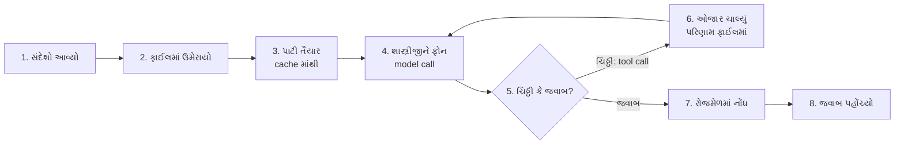

# સમગ્ર નકશો — આખું પુસ્તક એક નજરે

> આ પાનું આખા પુસ્તકનો નકશો છે. પહેલાં આ વાંચો; પછી દરેક પ્રકરણ પૂરું કર્યા પછી અહીં પાછા આવો અને જુઓ કે નકશાનો કયો ભાગ હવે તમારો થઈ ગયો.

## આ પાનું વાંચ્યા પછી તમે શું કરી શકશો

- એક વાક્યમાં કહી શકશો કે Hermes Agent શું છે અને તે બીજા agents થી શેમાં જુદું છે.
- વાર્તાના દરેક પાત્રને Hermes ના એક ભાગ સાથે જોડી શકશો.
- દસ પ્રકરણોનો ક્રમ અને દરેકનો એક પ્રશ્ન કહી શકશો.
- Hermes ની બે મૂળ invariants (કદી ન તૂટતા નિયમ) યાદ રાખી શકશો; આખું પુસ્તક તેના પર ઊભું છે.

## 1. એક વાક્યમાં આખું પુસ્તક

**Hermes Agent એક એવો સહાયક છે જે કામ કરતાં કરતાં શીખે છે: અનુભવમાંથી રીત લખી રાખે છે, તમારા વિશે નોંધ રાખે છે, જૂની વાતચીત શોધી શકે છે, અને terminal, Telegram કે WhatsApp — જ્યાંથી બોલાવો ત્યાંથી એ જ સહાયક હાજર થાય છે.** ([README][readme-learning-loop]) ✅

અને આ પુસ્તક એ સહાયકને **અંદરથી** ખોલે છે: દરેક વર્તન પાછળ કયો code છે, એ નિયમ કેમ બન્યો, અને તે તૂટે તો શું બગડે.

## 2. વાર્તા: 14 દિવસ, એક વેડિંગ-પ્લાનિંગ ઑફિસ

વડોદરાના અલકાપુરીમાં **"શુભમંગલ વેડિંગ પ્લાનર્સ"** છે. માલિક **સ્મિતાબેન**. તેમની દીકરી **ઈશા** 12મું પાસ કરીને college ની રાહ જુએ છે. ડિસેમ્બરમાં પટેલ પરિવારનાં લગ્ન છે — કાવ્યા અને ધ્રુવ — અને ઑફિસમાં કામનો ઢગલો છે.

ઈશાના **નિખિલમામા** software engineer છે. તે 14 દિવસ રોકાય છે અને રોજ એક પગથિયું શીખવે છે. શીખવવાની રીત એક જ: ઑફિસમાં આજે જે **ઘટના** બની, એ જ Hermes નો એક **નિયમ** છે. ઘટના યાદ રહે, એટલે નિયમ યાદ રહે.

ઑફિસનું કામ આમ ચાલે છે:

- **શાસ્ત્રીજી** કાશીમાં રહે છે. લગ્નની દરેક વિધિ, દરેક હિસાબ, દરેક ભાષા જાણે છે. પણ તેમના ત્રણ સ્વભાવ છે: તે ફક્ત **ફોન** પર મળે, **શબ્દ દીઠ ફી** લે, અને ફોન મૂકતાં જ **બધું ભૂલી જાય**.
- **હર્ષ** ઑફિસનો સહાયક છે. શાસ્ત્રીજીને ફોન એ જ કરે, તેમના કહેવા પ્રમાણે દોડધામ એ જ કરે, અને બધું ચોપડામાં એ જ લખે.

શાસ્ત્રીજી ભૂલી જાય છે, એટલે હર્ષ દરેક ફોનમાં **આખી ફાઈલ શરૂઆતથી વાંચી સંભળાવે છે**. શાસ્ત્રીજીની એક સગવડ છે: ફાઈલનો જેટલો શરૂઆતી ભાગ ગયા ફોન જેવો **અક્ષરશઃ એ જ** હોય, તેટલા ભાગની ફી તે લગભગ માફ કરે છે. આ એક સગવડ પર ઑફિસના અડધા નિયમો ઊભા છે.

### વાર્તા કેવી રીતે technical શીખવે છે

દરેક પ્રકરણ **દૃશ્યો** માં ચાલે છે, અને દરેક દૃશ્ય ચાર પગથિયાંમાં:

| નિશાન | પગથિયું | ઉદાહરણ (પ્રકરણ 2) |
|---|---|---|
| 🎬 | **ઘટના** — ઑફિસમાં કંઈક બને છે | ઈશા બપોરે સૂચના-પાટી પર એક લીટી ઉમેરે છે; મહિનાનું ફોન-બિલ બમણું આવે છે. |
| ❓ | **ઈશાનો પ્રશ્ન** | "એક લીટીમાં આટલો ખર્ચ કેમ?" |
| 💻 | **Code માં** — એ જ નિયમ pinned source માં | System prompt વાતચીત દરમિયાન byte-stable; ત્રણ થર `stable → context → volatile`. |
| 🔬 | **Expert નજર** — નિયમ કેમ બન્યો, તૂટે તો શું બગડે | Cache prefix પર ચાલે છે; શરૂઆત બદલો તો પાછળનું બધું ફરી પૂરા ભાવે. |

વાર્તા અને ખરા વર્તન વચ્ચે જ્યાં ફરક છે, ત્યાં ⚠️ સ્પષ્ટ કહે છે કે ખરું વર્તન શું છે.

## 3. કોણ કોણ છે: શુભમંગલ વેડિંગ પ્લાનર્સ

| વાર્તામાં | Hermes માં | એક લીટીમાં | પ્રકરણ |
|---|---|---|---|
| **શાસ્ત્રીજી** (કાશી, ફક્ત ફોન) | AI model (LLM) | વિચારે, પણ હાથ-પગ નથી; દરેક ફોન પછી ભૂલી જાય | પ્રવેશ, 1 |
| **હર્ષ** | `AIAgent` — agent loop | ફોન કરે, ઓજાર ચલાવે, ફરી ફોન કરે | 1 |
| **ફોન-ફાઈલ** | `messages` list | દરેક ફોનમાં આખી વંચાય | 1 |
| **ચક્કર-મર્યાદા** | `IterationBudget` | એક કામ પાછળ કેટલા ફોન | 1 |
| **સૂચના-પાટી** | System prompt | સવારે લખાય; દિવસભર ન બદલાય | 2 |
| **ફી-માફી** | Prompt caching | સરખી શરૂઆત સસ્તી | 2 |
| **ઓજાર-કબાટ** | Tool registry | દરેક ઓજાર પોતાની ચિઠ્ઠી સાથે જાતે ગોઠવાય | 3 |
| **થેલા** | Toolsets | કયા કામે કયાં ઓજાર લઈ જવાં | 3 |
| **સ્મિતાબેનની સહી** | Dangerous-command approval | જોખમી કામ પહેલાં પૂછો | 3 |
| **ખિસ્સા-ડાયરી**, **ગ્રાહક-કાર્ડ** | `MEMORY.md`, `USER.md` | નાની, મર્યાદિત, કાયમી નોંધ | 4 |
| **રોજમેળ** અને તેની અનુક્રમણિકા | `state.db` (SQLite + FTS5) | દરેક વાતચીત; શબ્દથી શોધાય | 4 |
| **સાર-નોંધ** | Context compression | ફાઈલ જાડી થાય ત્યારે વચ્ચેનો ભાગ ટૂંકો | 4 |
| **રીત-પોથી** | Skills (`SKILL.md`) | "આ કામ આમ કરાય" — હર્ષ જાતે લખે | 5 |
| **બારીઓ** | Gateway + platform adapters | Telegram, WhatsApp, terminal: એક જ હર્ષ | 6 |
| **રઘુકાકા** (ચોકીદાર) | User authorization | યાદીમાં નામ નથી? અંદર નહીં | 6 |
| **એલાર્મ-ચોપડી** | Cron | "રોજ સવારે 8 વાગ્યે" | 6 |
| **શિખાઉ** (જય, પરી) | Subagents (`delegate_task`) | કોરી ફાઈલ લઈને જાય; ફક્ત સાર લાવે | 6 |
| **બહારના કારીગર** | Plugins | ઑફિસની દીવાલ તોડ્યા વગર નવું ઓજાર | 7 |
| **સુરતની શાખા** | Profiles | અલગ ઘર, અલગ ચોપડા | 0, 7 |
| **બીજા પંડિત** | Fallback provider | શાસ્ત્રીજીનો ફોન ન લાગે તો | 7 |

## 3a. મુખ્ય ઘટનાઓ: આખું પુસ્તક "ઘટના → નિયમ" માં

| # | 🎬 ઘટના | 💻 નિયમ | તૂટે તો |
|---|---|---|---|
| 1 | શાસ્ત્રીજી ફોન મૂકતાં જ ભૂલી જાય | દરેક model call માં આખો history જાય | Model "ગયા વખતે" ને ઓળખે જ નહીં |
| 2 | હર્ષ એક કામ માટે ત્રણ ફોન કરે | Turn = એક કામ; iteration = એક model call | ખર્ચ અને ઝડપ સમજાય નહીં |
| 3 | હર્ષ હોલવાળા પાસે 40 ચક્કર મારે | Iteration budget | અનંત loop, અનંત બિલ |
| 4 | બપોરે પાટી બદલી, બિલ બમણું | System prompt byte-stable | Cache તૂટે, ખર્ચ વધે |
| 5 | કબાટમાં 200 ઓજાર, દરેક ફોનમાં યાદી વંચાય | Core tools ઓછાં; બાકી skill/plugin | દરેક call મોંઘો, model ગૂંચવાય |
| 6 | હર્ષ જૂની ફાઈલોનો આખો કબાટ ફેંકવા જાય | Dangerous-command approval | એક command માં ડેટા ગયો |
| 7 | ડાયરીમાં લખ્યું, છતાં આજે "યાદ નથી" | Memory = frozen snapshot | — (આ bug નથી, design છે) |
| 8 | ડાયરી ભરાઈ ગઈ | અક્ષર-મર્યાદા; ભરાય તો error | Prompt ફૂલે, નકામી નોંધો વધે |
| 9 | ફાઈલ એટલી જાડી કે ફોનમાં ન સમાય | Compression (50% પર) | Context overflow, turn નિષ્ફળ |
| 10 | એ જ ભૂલ બીજી વાર | Skill: procedure લખી રાખો | દર વખતે શૂન્યથી શીખવું |
| 11 | અજાણ્યો નંબર ઑફિસને હુકમ આપે | Default: deny | કોઈ પણ તમારું agent ચલાવે |
| 12 | લાઈટ ગઈ; એલાર્મ બે વાર વાગે? | `next_run` પહેલાં ખસે, પછી કામ | એક કામ બે વાર |
| 13 | શિખાઉ આખો દિવસનો અહેવાલ વાંચી સંભળાવે | Subagent: ફક્ત સાર parent માં | Parent નો context ભરાઈ જાય |
| 14 | કારીગર ઑફિસની દીવાલ તોડવા માગે | Plugins core ને અડે નહીં | દરેક update માં ભંગાણ |

## 4. દસ પગથિયાંની નિસરણી: દરેક પ્રકરણ એક પ્રશ્નનો

| Level | દિવસ | પ્રકરણ | એક પ્રશ્ન |
|---|---|---|---|
| −1 | 1 | [પ્રવેશ — શૂન્યથી શરૂઆત](pravesh-shunya-thi-shuruaat.md) | Agent એટલે શું, 45 line માં? |
| 0 | 2 | [પાયો અને પ્રથમ run](00-paayo-ane-pratham-run.md) | Hermes ક્યાં રહે છે, અને કઈ file કોની? |
| 1 | 3–4 | [એક સંદેશાની આખી મુસાફરી](01-ek-sandesh-ni-musafari.md) | એક સંદેશાથી જવાબ સુધી શું શું થાય? |
| 2 | 5 | [સૂચના-પાટી: prompt અને cache](02-suchna-pati-prompt-ane-cache.md) | Model ને દરેક વખતે શું કહેવાય, અને તે કેમ ન બદલાય? |
| 3 | 6–7 | [ઓજાર-કબાટ: tools](03-ojar-kabat-tools.md) | Agent ના હાથ ક્યાંથી આવે, અને તેને કોણ રોકે? |
| 4 | 8–9 | [યાદ: memory, sessions, compression](04-yaad-memory-sessions.md) | ભૂલકણા model સાથે agent કેવી રીતે યાદ રાખે? |
| 5 | 10 | [રીત-પોથી: skills](05-reet-pothi-skills.md) | Agent અનુભવમાંથી કેવી રીતે શીખે? |
| 6 | 11–12 | [બારીઓ, ઘડિયાળ અને શિખાઉ](06-bario-ghadiyal-shikhau.md) | એક agent અનેક જગ્યાએ, અનેક સમયે, અનેક હાથે કેવી રીતે? |
| 7 | 13–14 | [પોતાનું ઓજાર અને mastery](07-potanu-ojar-ane-mastery.md) | Hermes ને તોડ્યા વગર કેવી રીતે વિસ્તારવું? |

### યાદ રાખવાની ચાવી: "ઓળખ – ઘર – ચક્કર – પાટી – ઓજાર – યાદ – રીત – બારી – કારીગર"

નવ શબ્દ, નવ પ્રકરણ, એ જ ક્રમમાં. દરેક શબ્દ આગલા પર ઊભો છે: agent ને **ઓળખ્યા** વગર તેનું **ઘર** ન સમજાય; **ચક્કર** (loop) વગર **પાટી** (prompt) નો અર્થ નથી; **ઓજાર** વગર **યાદ** લખાય નહીં; **યાદ** વગર **રીત** શીખાય નહીં.

## 5. બે invariants: આખું Hermes આ બે વાક્ય પર ઊભું છે

Hermes ની પોતાની development guide લખે છે કે બે invariants "લગભગ દરેક design decision" ઘડે છે ([AGENTS.md][agents-invariants]) ✅:

1. **"Per-conversation prompt caching is sacred."** વાતચીત ચાલુ હોય ત્યારે ભૂતકાળનો context બદલવો, toolsets બદલવા, memory ફરી લોડ કરવી કે system prompt ફરી બનાવવો — આ બધું cache તોડે છે અને વપરાશકર્તાનો ખર્ચ વધારે છે. એકમાત્ર અપવાદ: context compression.
2. **"The core is a narrow waist; capability lives at the edges."** દરેક model tool દરેક API call માં મોકલાય છે, એટલે નવા core tool માટે ધોરણ ઊંચું છે. નવી ક્ષમતા skill, plugin કે service-gated tool તરીકે આવે.

વાર્તાની ભાષામાં:

1. **"પાટી દિવસભર અડશો નહીં."**
2. **"કબાટ નાનો રાખો; નવું ઓજાર બહારના કારીગર લાવે."**

દરેક પ્રકરણમાં તમે જોશો કે કોઈ વિચિત્ર લાગતું વર્તન (ડાયરીમાં લખ્યું છતાં આજે દેખાતું નથી!) આ બેમાંથી એક નિયમનું સીધું પરિણામ છે.

## 6. એક સંદેશાના આઠ સ્ટેશન (પ્રકરણ 1 નો સાર)

## 7. તમારા સ્તર પ્રમાણે વાંચવાનો માર્ગ

| તમે | શરૂઆત | પછી |
|---|---|---|
| Programming બિલકુલ નથી આવડતું | પ્રવેશ | 0 → 7 ક્રમમાં |
| Python આવડે છે, agents નવા છે | પ્રવેશનું છેલ્લું દૃશ્ય (રમકડા-agent) | 0 → 7 |
| બીજું agent framework વાપર્યું છે | પ્રકરણ 1 | 2, 4, 5 (Hermes ની ખાસિયત) |
| Hermes માં contribute કરવું છે | પ્રકરણ 0 નો repo નકશો | 2, 3, 7 |

**બે વાંચન.** પહેલી વાર 🔬 ઝડપથી વાંચો, labs ચલાવો. બીજી વાર 🔬 પર અટકો અને દરેક pinned link ખોલો.

## 8. આ પુસ્તકની પ્રામાણિકતા: ત્રણ નિશાન

| નિશાન | અર્થ |
|---|---|
| ✅ | Pinned commit નો source કે doc વાંચીને ચકાસ્યું; link સાથે. |
| 🧪 | આ પુસ્તક લખતી વખતે **ચલાવીને** ચકાસ્યું; output `evidence/` માં. |
| ⚠️ | ચલાવીને ચકાસ્યું **નથી**, અથવા વાર્તા અને ખરા વર્તન વચ્ચે ફરક છે. |

**એક સ્પષ્ટ કબૂલાત.** આ પુસ્તક જે environment માં લખાયું ત્યાં Hermes Agent install કરવાની પરવાનગી નહોતી. એટલે:

- પુસ્તકની **પોતાની labs** (`labs/` — ફક્ત Python standard library) 🧪 ચલાવેલી છે. તે Hermes નો દરેક નિયમ નાના, વાંચી શકાય તેવા રૂપમાં ફરી બનાવે છે.
- **`hermes …` commands** pinned docs અને source માંથી લીધેલા છે (✅), પણ ચલાવેલા નથી (⚠️). તમે ચલાવો ત્યારે output જુદું દેખાય તો [verification log](../appendix/F-verification-log.md) માં નોંધવા જેવું છે.

Expert developer ની પહેલી ટેવ આ જ છે: **"મેં વાંચ્યું" અને "મેં ચલાવ્યું" ને કદી ભેળવવું નહીં.**

## 9. આ નકશો કેવી રીતે વાપરવો

1. અત્યારે: વિભાગ 3 નું table એક વાર મોટેથી વાંચો. ન સમજાય તો વાંધો નથી.
2. દરેક પ્રકરણ પછી: વિભાગ 3a ની એ પ્રકરણની ઘટનાઓ પર આંગળી મૂકો અને નિયમ **જોયા વગર** બોલો.
3. છેલ્લે: વિભાગ 5 ની બે invariants પરથી વિભાગ 3a ની ચૌદ ઘટનાઓ સમજાવો. એ થાય, તો પુસ્તક તમારું થયું.

આગળ: [પ્રવેશ — શૂન્યથી શરૂઆત](pravesh-shunya-thi-shuruaat.md).

<!-- refs:start (generated by tools/citations.py) -->
[agents-invariants]: https://github.com/NousResearch/hermes-agent/blob/93dd2a4efb0709ceac09969b85d306e768b53815/AGENTS.md#L16-L25
[readme-learning-loop]: https://github.com/NousResearch/hermes-agent/blob/93dd2a4efb0709ceac09969b85d306e768b53815/README.md#L19
<!-- refs:end -->
